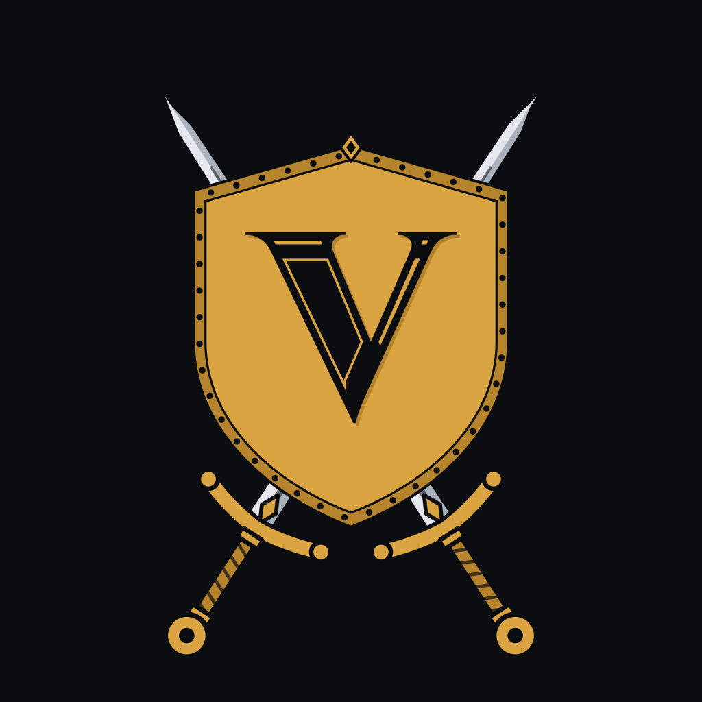

# Vanguard

<p align="center"></p>

> **Formerly ForeverUI.** Renamed in 0.4.0 because another, unrelated addon called ForeverUI is published on CurseForge and Wago, and two addons with the same folder name overwrite each other. The slash commands are now `/vg` and `/vanguard`. Settings don't carry over by themselves (the saved-settings file is named after the addon): before updating, type `/fui export` in game and keep the string; after updating, `/vg import` it (old ForeverUI strings import fine). Then delete the old `Interface/AddOns/ForeverUI` folder.

A from-scratch UI suite for WoW Forever (the 12.1 engine with vanilla content; the TOC declares Interface 16001 for Forever and 120007).
Written from scratch. It contains no code, art or fonts from other UI addons. It bundles three small shared libraries, unmodified, in `Libs/`: LibStub, CallbackHandler-1.0 and LibSharedMedia-3.0, which addons use to share fonts and bar textures (see Credits).

## What's in it

- **Look and layout**: the Slate & Brass theme: flat slate panels (floating windows get a soft shadow; frames on the HUD stay flat unless you turn on Soft shadows under frames), a brass accent (or arcane, jade, orchid, copper; the older names fel, void and ember still work, and a profile that picked one keeps its colour), state colors kept off the red-green axis, a Color assist switch under General → Look that turns friendly, neutral and hostile into blue, yellow and vermilion (after a reload), bundled Fira Sans Condensed, pixel-perfect borders, smooth bars (Vanguard, Soft or Flat bar texture), shared fonts and bar textures (the Font picker under General lists Vanguard's two fonts and the one you use if it comes from another addon, the Bar texture picker also lists every bar texture other addons share through LibSharedMedia, and Vanguard shares its own font and bars the same way; if the addon behind your pick is gone, Fira Sans Condensed and the Vanguard bars come back), soft sparks on cast and power bars, buttons that ease into a lighter fill under the mouse, go a shade darker with their label a pixel lower while pressed, and grey their label when they can't be used, windows that rise a few pixels into place as they open (at once in combat), quiet fades (never longer than 0.15 s in combat) and interface sounds (Reduce motion and Interface sounds switches turn them off; every fade and sound is listed in `docs/THEME.md`). Vanguard's own windows share one look. The options window, setup, What's new, the quest log, the group board, the unlock popover and every dialog (export and import, questions, the reload offer, feedback, the wizards, the auction filters) have a title at the top left in the body text colour (setup and What's new centre theirs), a close button in the top-right corner and Escape to close them (the quest dialog has no close button: Goodbye and Escape end the talk). In dialogs and the setup wizard Tab and Shift-Tab move a focus ring along the buttons, and Enter or Space presses the one it is on (out of combat); in the options window Left and Right step a focused slider, a dropdown keeps its lit fill while its menu is open, and Escape or a click outside closes the menu; an edit box's border turns the accent colour while you type, a search box shows a clear glyph while it has text, and a pressed switch drops its knob a pixel without changing colour. Where a window scrolls (the options pages, What's new, the quest log and quest dialog, the text and lists in the dialogs), the scroll thumb is one thin line with soft edges and no arrows, while the auction tables, the dropdown menus and the click-cast spell picker scroll with the mouse wheel alone; section headings are small grey capitals; a chosen list row has an accent bar along its left edge over a lighter fill, and a row presses a shade darker under the click; and a dialog has at most one accent button, on the action it exists for (Import, Export, Reload, Save, Make report), while Yes, No, Cancel and Later stay plain (the accent button has a bold dark label and eases to a lighter accent under the mouse; a button that deletes keeps the plain look with a red label). Dropdowns and sliders share one 200-wide control column on the right of an options row, and a long caption wraps to its left. Every frame can be moved in unlock mode (`/vg unlock`), with a grid, snapping and arrow-key nudging; a bar at the top of the screen offers **Save and lock** (the same as `/vg lock`) and **Exit without saving**, which puts every frame back as it was when you unlocked (spot, links, size, scale and opacity) and locks (when the game's Edit Mode shows the handles there is no bar: closing Edit Mode keeps your changes). Right-click a frame's handle to set its anchor, exact offsets, scale (50% to 200%) and opacity (10% to 100%), or pick a frame under General → Layout and use its Scale and Opacity sliders. The popover opens just right of the handle, its title says which frame it is and where it is anchored, and it closes with Done, its close button or Escape. A scaled frame grows around its anchor point, which stays where it was; a frame that fades by itself (a mouseover bar, say) still fades, at its opacity. A frame can also be anchored to another frame instead of the screen: in its popover pick **Anchor to** (a frame) and a **Side** (left, right, top or bottom) with typed X and Y offsets from it; it then follows that frame when it moves, is reset, rescaled or resized (out of combat), grows away from it (anchored to its right, it grows to the right), keeps the link when you drag or nudge it (the offsets change), and while that frame isn't there (its module off) sits at its last spot, never off screen. The cast bars (width) and the XP and reputation bars (width and height) can match another frame's width or height (**Match width**, **Match height**), kept as that frame changes, or take a size of their own from the Its width and Its height sliders under General → Layout; a matched slider is locked, and hovering it says what it matches and how to unmatch. A link that can't be (to the frame itself, round in a circle, a size the frame can't be, or a frame Vanguard doesn't size) is refused, and the popover says why. Scale, opacity, links and sizes are saved with the frame's position, go with the profile (export, import, switching), and `/vg reset` puts them back (100%, on the screen, its own size). The game's Edit Mode shows Vanguard's handles too, with a note under its window, so you can move everything in one place (a switch under General turns that off). Vanguard's frames replace the game's, so Edit Mode shows no handle for a game frame Vanguard has hidden (the game's action bars, XP and reputation bars, unit, boss and cast bar frames, the quest tracker while Vanguard's is on, and the rest); it keeps every system Vanguard doesn't replace. Profiles can be exported and imported, and can switch with your spec (on clients that have specializations). An export holds the whole profile or only the parts you pick: **Choose what to export** on the Profiles page (or `/vg export pick`) has a switch for Layout (positions and movers), Situations overrides, Global settings (theme, modules list, skins) and each module with saved settings, and `/vg export layout` and the like name parts in chat. A partial string imports into the profile you use, its values replacing yours key by key while every setting it doesn't carry keeps your value (a frame's spot and a situation's override are replaced whole). Every string says its format and the Vanguard version that made it, and a string from an older version (or from ForeverUI) is upgraded as it imports; a large one imports a little each frame, with how far it has got ("Importing… 40%") in the import box's title, and one Vanguard can't use says why. Before any import, the profile you use is copied into one backup profile, `<name> backup` (each import replaces it), and chat says so; a font or bar texture the string names that this client doesn't have is named in chat, with what Vanguard draws instead. A whole profile whose settings match one you have (your own export, say) switches to that one instead of making a copy, and says so. A whole-profile string also carries the UI scale and screen size it was made on: importing one asks whether to use its UI scale (the game's own UI scale setting, applied out of combat), then offers the reload. A profile remembers which of the game's Edit Mode layouts you use with it (that goes in its string too): when a character loads a different profile than last time (a switch, a spec profile or an import), Vanguard switches Edit Mode to that layout, out of combat, if your account has one of that name, and says so in chat; characters sharing a profile keep their own layouts. Choosing a profile (the list under `/vg` → Profiles, the picker at the top of the window, `/vg profile <name>`, an imported whole profile or a spec change) takes effect when you reload: until then the frames on screen still belong to the profile you were using, so moving a frame or changing the accent changes that one, and the Profiles page says which profile comes next (**Use** on the profile in use takes the switch back).
- **Centered layout**: everything near the action is anchored to the bottom center of the screen, so the layout keeps its shape at any UI scale. Player and target sit either side of your character with your cast bar and swing timer between them, the pet and target of target outside them, the focus above the player, and three bars of 38 px buttons under them over thin XP and reputation bars. A party or a raid of 10 grows up from just above your player frame, centered on it. A bigger raid (25 or 40) moves to the left of your character, as healers usually keep it, so the boss and your own frames stay in view, and stacks its groups as rows (five across, one group above the next): its left edge is 620 units left of the screen's middle and its bottom 344 up, clear of your pet and focus. A raid of more than 10 is also drawn smaller (80%, or 72% above 25) so all 40 fit. **Stack big raids at the left (more than 10 players)** on the Raid frames page in `/vg` turns that off (a big raid then stays over your player frame, in columns). Frames you moved keep their spot at every group size; only the defaults changed. `/vg reset raid` forgets a saved spot (the one setup's Healing layout used to save, or one you dragged to) and puts the raid frames at the default, the grid following at once. Chat starts in a bottom-left spot under the frames, sized once; move it with `/vg unlock` (the game's own layout and your resizing are left alone after that), or switch the spot off under Chat. A test checks that nothing overlaps or leaves the screen, solo to 40-man, at UI scale 1.0 and pixel-perfect, and with each of setup's screen presets on the screen it is made for. Frames you moved keep their spot; `/vg reset all` puts everything back.
- **Unit frames**: player, target, target of target, focus and party frames, and boss frames (up to five, in a column from the top-left corner, each shown while its boss is in the fight; the game's own boss frames are hidden). The player and target frames are 240 x 36 with 12 px names, sized for a 1080p screen at setup's 80% UI scale. On WoW Forever they show levels (colored by difficulty) and health as a percent, and a diamond marks elite, rare and boss targets. **Calm HUD** (off until you turn it on under Unit frames, in setup's look step, or for one situation): out of combat your player, pet, target, target of target and focus frames dim to a third, and they come back at once in a fight, while you target a living hostile unit, or under the mouse; only their opacity changes, so they stay clickable, and the client switches them in combat too. **Versus deck** (off until you turn it on under Unit frames, or pick the Versus deck layout in setup): one shield-cornered panel with an accent border joins your player and target frames across the middle (under your cast bar, swing timer and cooldowns, which stay where they are), with the Vanguard crest centred on its top edge, both frames' names and health in the larger title text, and your target's health and power fill from the right, so the pair reads as a duel; it dims with the Calm HUD, and it follows the two frames wherever you move them. Combo points for rogues and druids above the player frame. Under it, shamans get their totems (icon and time left; right-click one to destroy it) and druids their mana while bear or cat form shows rage or energy: the game keeps both inside its own player frame, which Vanguard replaces.
- **Combat timers**: a swing timer with a row per hand (main hand, off hand, and ranged for a hunter's Auto Shot), from WoW Forever's own swing events. It is on for warriors, rogues and hunters, and can be set to always or never. While it is on, the game's own swing timer (its Show Swing Timer setting) is hidden; while it is off, the game's bars are drawn in the theme, each hand in its row's color. On your power bar, a spark counts down the five-second rule after each mana spell, or crosses the bar with every two-second energy tick.
- **Readouts**: your threat on your target as a percent above the target frame (in the threat colors once you have aggro), and a glyph on the pet frame for a hunter pet's happiness: a green check happy, an amber triangle content, a red cross unhappy. Each shows only where the client answers. A **status chip** (off until you tick it under Unit frames, then reload) sits above the player frame's top-left corner: the buff's own icon and "Eating", "Drinking" or "Well Fed" while that buff is on you, else, if Instance prep's buff checks are on, a warning glyph and "Missing: Flask +2" (the first thing those checks find missing and how many more) in the warning color. It reads your auras out of combat only: it goes the moment a fight starts, stays away through it and while the client hides aura values or you are dead, and shows nothing on a client without the aura lookup.
  - Target and focus auras: debuffs under the frame (a crowd-control slot, then yours soonest-first, then others' dimmed if you turn "Only your debuffs" off), the target's buffs above it, each row wrapping at the frame's width. Timer numbers are off by default (the dark sweep shows time left) and can be turned on.
  - Cast bars for you, your target and your focus, with a spark, the seconds left, your latency at the end of your own cast, and a gray edge on a cast you can't interrupt. The game's own cast bar over the professions window while you craft stays, in the theme's bar and font. **Ring at the cursor: the global cooldown and your cast** (Unit frames → Cast bars; off by default, applied at once) puts two thin rings on the mouse pointer: the outer one sweeps the global cooldown away, the inner one fills as your cast goes (and empties for a channel). They are drawn from the client's own duration objects, so they work in combat when the numbers are hidden; the ring takes no mouse input, so clicks and tooltips go through it, and it follows the pointer only while it shows. Interrupt mark beside the target and focus cast bars** (Unit frames → Cast bars; on by default, applied at once) puts a small diamond to the right of those two bars while their cast can be interrupted and you know an interrupt (Kick, Pummel or Shield Bash, Counterspell, Earth Shock, Silence): a filled accent diamond when it is ready, a hollow dim one, darkened like a cooldown sweep, while it recovers. The sweep takes the client's own cooldown object, so it works in combat when the numbers are hidden, and the mark is not drawn for a cast you can't interrupt, for a class without a vanilla interrupt, or when the client won't say.
- **Your buffs and debuffs** replace the game's buff frame (and the external defensives and deadly debuff frames of newer clients, WoW Forever's among them): buffs in rows left of the minimap with timers, your debuffs on a new row under them (edged in their type's color); right-click a buff to cancel it. Weapon enchants (poisons, stones, oils, and a shaman's imbues on WoW Forever, which the game's own enchant cells miss) sit in front of the buffs. Move them with `/vg unlock`.
- **Raid frames** (built for healers):
  - Laid out in zones that never overlap: name at the top, status (missing health, Dead, Offline) under it, the missing-buff mark in the top-right corner, debuffs bottom left, your HoTs bottom right, the power bar along the bottom, and the ready check and resurrection big in the center. Default tile 100 x 48, drawn smaller in bigger raids. The missing-health text grows and shrinks with the tile but never drops under the theme's smallest text size on screen (10 px at 100% text size); on a grid drawn smaller (more than 10 players) it moves to the right end of the name row to keep that size.
  - Readable at a glance: class colors softened into the panel color by default, with a 1-pixel line in the full class color along each tile's top so close colors (shaman and mage blues, rogue and paladin yellows) still tell apart (or dark bars with class-colored names, or bright class colors), outlined names that end in "..." when too long, and a dark bar on the dead and offline. In instanced combat, where the game keeps health secret from addons, the bars still fill and the missing-health text hides.
  - Auras: the first debuff you can dispel, then up to two others (boss debuffs included); your HoTs, lit while they're in their refresh window; no timer numbers on these small icons. A debuff you can dispel washes the tile in its type's color from the bottom and colors its edge. Every debuff icon carries its type's letter in its corner (M, C, D or P), so the type reads without its color.
  - Healing: click casting and hover keybindings (a hover key can carry Shift, Ctrl or Alt: while the pointer is over a frame, Shift-Q casts on that player), incoming heals and shields, aggro strip, missing-buff marker (hidden while the game hides auras, so it never cries wolf), an accent edge on your target, a faint wash under the mouse.
  - Status: range fade, raid target icons, ready check (a check, cross or three dots in the theme colors), resurrection marker, and a gold crown for the leader and a small diamond for assistants. While the ready check or resurrection mark shows in the middle, the missing-health text steps aside.
  - Roles: a small shield for tanks and a cross for healers before the name; damage dealers get no mark. The raid's main tank gets the shield in your accent color, and the main assist in gray.
  - Groups as columns (the default) or rows: columns put each group's five players in a column, with the groups side by side; rows put each group's five in one row, with the groups stacked upward, so a big healing raid is wide and short. Pick it with **Groups as** on the Raid frames page in `/vg`; a change takes a reload. Whatever you pick, a raid of more than 10 stacks as rows unless you turn off **Stack big raids at the left**.
  - Preview without a group: **Preview with sample players** at the bottom of the Raid frames page (or `/vg preview party`, `10`, `25`, `40`, `off`) fills the tiles with made-up players (classes, roles, missing health, one dead and one offline) as a party of five or a raid of 10, 25 or 40, where your raid frames sit, drawn smaller for the bigger raids as the real grid is. A new width, height, style, sorting or Groups as shows in the preview at once, while the real frames still take a reload. The preview is never saved: it ends when you turn it off, join a group, enter combat or reload, and it won't start in a group or a fight. The party preview shows the raid tiles, as your party sees them with **Use them for your party too** on (the default); the separate party frames used with that switch off aren't previewed. The real frames are left alone throughout.
- **Click casting** (`/vg` → Click casting), set up without typing a spell:
  - **Starter layout**: one button fills the grid with your class's healing layout (Priest, Druid, Paladin, Shaman; Mage and Warlock get their buffs). Spells bind by name, so one you haven't learned yet starts working the day you learn it. Left click stays Target and middle click the unit menu.
  - **The grid**: mouse buttons down the side, Plain / Shift / Ctrl / Alt across the top (More modifiers adds the combinations); each cell shows the bound spell's icon. Click a cell to pick from your own spellbook, right-click to clear it, or drop a spell from the spellbook or a bar onto it.
  - **The picker** lists what you can cast on friends in groups (Heals, Protect & cleanse, Buffs, Other), with a search box and the spell's tooltip on hover. A spell with ranks binds as its highest rank unless you open its ranks and pick one (for downranking); then the cell says "Flash Heal (Rank 3)". Under the spells: Target, Unit menu, Focus, Assist, a macro, or a typed spell name.
  - **Hover keys**: Add key (at the top of its card, with a hint beside it until you have one), press the key (Shift + Q, the wheel...), pick the spell; the row says when the key is also an action-bar binding ("also Action bar 1 slot 2"), which it keeps doing off the frames.
  - **Try it**: hover the sample tile and press or click; it says what would happen ("Shift + Right click -> Renew on you") without casting.
  - **Share**: Export and Import the bindings as a string, and copy them to another spec where the client has specs. Bindings are per character and spec; changes apply at once, or when the fight ends if you're in one.
  - **The game's click bindings** (where the client has its own click casting): a switch at the bottom of the page, off by default, uses the game's instead. Vanguard's bindings and hover keys then rest (kept for when you switch back, and `/vg binds` says so), and the bindings you set in the game's Click Casting window (the page's button opens it) work on the raid and unit frames. The switch applies out of combat; turned on in a fight, it waits for the fight to end.
- **Raid tools**: for the group's leader and assistants, a small bar at the top left with a ready check, a 10-second pull timer (right-click cancels it), a role check and Raid (turns your party into a raid), the eight raid target icons (click to mark your target; the last button clears it) and the eight world markers (click to place or remove one; right-click clears it; the last button clears them all). It shows and hides out of combat.
- **Action bars**: range and power tint, plus restyled pet, stance and extra action buttons and a vehicle exit button. The restyle keeps what the game lights up by state: the active stance, the pet's attack flash and the auto-cast mark. The possess bar's two buttons, shown while you mind-control, get the same restyle. The pet and stance bars sit in spots of their own at the bottom left, above the chat and clear of your bars (the game's own spot for them lies over the bar stack); move them with `/vg unlock`, or turn that off under Action bars to leave them to Edit Mode.
  - The bottom bars stack with bar 1 on top; turning on another bottom bar adds it underneath. Each row takes its bar's real height, so a bar with bigger buttons or more rows pushes the ones above it up, right away when you change it. A position you've dragged is kept; `/vg reset all` puts the bars back in this order.
  - Empty slots stay hidden until you drag a spell or item, so a new character sees no empty squares, and they take no mouse, so clicks and right-drag camera turns over blank bar space reach the game. A slot that fills or empties in combat (bar 1 paging into a form) shows or hides at once, but takes or releases the mouse only when combat ends; its key still works.
  - Hover a button for its action's tooltip, in the game's default spot; it follows the page bar 1 is on, and an empty slot shows none.
  - The game's self-cast, focus-cast and mouseover-cast options work on these buttons as on the game's own.
  - Keybind mode (`/vg keybind`, or **Keybind mode** under Action bars): hover a button and press a key, the middle or a side mouse button, or roll the wheel (with Shift, Ctrl or Alt held if you like) to bind it; the key replaces the button's keys, is saved in the game's own key bindings (for your account or this character, whichever you use), and shows on the button at once. A tooltip over the button shows its keys. Backspace or Delete clears them. A key that did something else (Move Forward, another button) is taken, and chat says from what. While the mode is on a click binds instead of casting (left and right click bind nothing, as in the game). A modifier pressed alone does nothing, a key pressed away from the buttons goes on to the game, and Escape leaves. Empty slots and faded bars show while it is on. It works out of combat only and ends when a fight starts.
  - Counts, icons and usability follow what you carry and wear (bags, equipment), your form, macro edits and spell charges, so a stack you use up or a form that changes an icon updates at once.
  - Each bar has its own number of buttons, buttons per row, button size, and visibility: Always, On mouseover (seen only while the mouse is over it), In combat, Hidden, or When checked below: a row of conditions under it (Combat, Mouseover, Group, Raid, Instance, Vehicle, Resting), and the bar shows while any checked one holds (with Mouseover checked it fades in under the mouse the rest of the time). The game itself shows and hides the bar on those conditions, in combat too; In an instance is re-checked whenever you change zone (after a fight, if you are in one). While you drag a spell or item, bars on mouseover or on conditions show too (the latter only when the drag starts out of combat).
  - Hidden bars keep their keys: the bar isn't drawn, but a bound key still casts, like a keybind-only bar. A Hidden bottom bar keeps its row in the stack (leaving a gap), because bars can't be re-stacked during combat.
  - The right-edge bars (4 and 5) start off; turned on, they show on mouseover. Profiles that already had them on keep them on Always.
  - With the Masque addon installed, Masque skins the buttons instead of Vanguard: its options list four Vanguard groups (Action bars; Pet, stance and extra buttons; Buffs and debuffs, with the weapon enchants; Target and focus auras), each with its own skin. Vanguard bundles nothing of Masque; without it nothing changes.
- **Nameplates**: class/reaction/threat colors, the name in outlined text with the level (colored by how hard the unit is for you), your debuffs (soonest to expire first, with timers) and your crowd control, casts, raid icon, an accent border, a 2-pixel accent glow and a diamond on your target, and a gold "!" by the name of units your quests need (only when the game says so plainly; a switch turns it off). Vanguard dresses every plate the game makes and never hides enemies, but the game makes none for hostile units while its Enemy nameplates setting is off, so Vanguard turns it on once, at each character's first login with this version; after that it is yours. The Nameplates page in `/vg` has the game's Enemy nameplates (the V key), Friendly players' and Friendly NPCs' nameplates switches, applied out of combat, and `/vg plates` says how many plates were drawn and what the game's plate settings are. Players' plates show their buffs right of the bar: big and external defensives and important buffs (immunities, major cooldowns) on friend and foe, and the buffs you cast on friendly players (3 a row by default; none, 3 or 5). A click lands on the plate as Vanguard draws it, the name and bar plus a little around them, and the client stacks plates by that same box; friendly players' plates stay clickable even with the game's name-only option for them on. The plate under the mouse gets a faint wash, so you can see which one a click will hit. A plate first drawn during a fight uses Vanguard's own icons (the client's aura containers can't be made in combat) and switches to the client's when the fight ends. With the game's personal resource display on (its Combat options, or `nameplateShowSelf`), the game's own health and power bars under your character take the plates' look: the theme's bar texture on a flat panel, their numbers in the plates' outlined font, with the game's colours, values and place.
- **Text size**: one slider (/vg > General, 70% to 130%) sizes all of Vanguard's text, chat and tooltips included, and applies at once. Chat has its own Small, Medium or Large on top (or keeps the game's own chat size if you prefer). `/vg status` shows your UI scale and how many pixels tall chat text draws on your screen.
- **The game's extras, tidied**: the game's own XP bar is hidden while Vanguard's shows (no more double XP bar), and so are the clock and calendar button while the info strip shows them (`/calendar` still opens the calendar) and the armoured-man durability figure whenever the info strip is on, its durability block or not (the strip's block and the character pane's gear labels carry the warning; switch the strip off to have the game's figure back). Tracking, mail, dungeon difficulty, the addon compartment and the group finder eye move onto the square minimap's corners (tracking and the addon compartment as slot buttons like the menu bar's, with Vanguard's icons, on the band along the map's bottom), and the expansion button (nothing to show in vanilla content) is put away; the game's emptied minimap frame at the top right stops taking mouse clicks and its zone button is put away. The bag buttons and the micro menu share one bar in the bottom-right corner: the bags (the key ring too, where the client has one, on the same slot as a bag) in a row centered over the menu buttons, with a thin accent line between them under the slots. The bar hugs its slots with a 12-pixel margin all round and grows to the left from its bottom-right corner as the game adds buttons. Every button sits on a slot 24 pixels wide with a 4-pixel gap (a slate tile with a beveled edge and a small soft shadow; the menu row's slots are 30 tall, the game's menu plates' own shape, so each plate fits its slot whole) and keeps the game's own icon and alert flash, fitted inside the slot; an inner edge in your accent shows under the mouse and darkens while you press, and a disabled menu button turns grey. Each bag's slot has a thin bar along its bottom showing how full that bag is (red when it is full; a soul bag or quiver counts only its own slots), an empty bag slot shows the game's empty-slot art faint and grey, and the backpack shows how many slots your bags have free. Vanguard's line icons stand in for the game's menu icons (on by default; the switch under Bars and bags brings the game's own back, and a profile saved before the bar was reworked keeps the game's icons until you switch). The bar is always shown; you can choose On mouseover, Auto-hide after 10 s (shown when you log in and while the mouse is over it, faded 10 seconds after the mouse leaves), In combat, Hidden or the same row of conditions as the action bars instead, under Bars and bags; it applies at once. The game's own bar frames are hidden inside it, and a spot you gave the menu strip is kept (a separate bag strip's spot is dropped, since the bags now ride in the bar). The quest tracker has its spot under the info strip: Vanguard's own tracker fills it, and only with that switched off does the game's tracker sit there instead, with flat headers, a brass line under each, the theme's collapse arrows and the theme font (quest colors stay the game's). The bar sizes itself to its buttons, re-fits whenever the game lays the bars out again, and stays where it's put when the game lays out its own frames. Each has a switch under Bars and bags.
- **Game windows**: the game's own windows keep their layout and buttons and get Vanguard's flat panel (opaque: the world doesn't show through), close button, title (every window's and dialog's title in the same size and light text, where the game centres it) and buttons; the sunk area behind a window's list or content (its inset) is a darker inset panel. Each group below has its own switch under Game windows (a reload applies it). The character pane, the combined bag, the group finder, the guild window, the spellbook and talents, the Legacy window, collections and appearances, the game menu, the auction house, friends, merchant, mail, professions and achievements can be dragged by their title bar and open where you dropped them; those and the calendar, the inspect window, trade, the dress-up window, the trainer, the guild bank, macros, the stable, the raid window, letters, the loot history, books, the add-ons list and help can also be dragged by an empty spot along their top edge (never one with a button on it), as can Vanguard's own options window; the world map, loot and roll windows, popups and the ready check stay where the game puts them. Nothing moves in combat: a window the game places during a fight goes back to your spot when the fight ends. The switch "Drag game windows by their title bar" (a reload applies it) and a "Reset window positions" button, which hands every window back to the game's placing the next time it opens, are under Game windows.
  - Character, merchant, mail, quest and gossip (only when Vanguard's quest dialog is switched off), trade, loot and roll windows, the game menu, the ready check, popups, the spellbook and the breath and fatigue bars get a flat Vanguard panel reaching a little past the window so its contents have room, close button (and the maximize and minimize buttons, with Vanguard's glyphs; the close button turns red under the mouse), title and buttons; tabs sit just outside the panel, the selected one raised and the others' icons greyed (the mail's Open All too; the game menu's buttons are made again each time it opens and are re-dressed each time, its header plate is faded away, and the Vanguard button on it matches). The loot window's rows lose the game's item cards: each slot is a square with a thin border in the item's quality colour, and the item's name and rarity are in the theme font. At a merchant, the rows and the buyback slot lose their slot and name plates the same way (the name and price in the theme font, the price still red when you can't pay), the repair and sell-junk buttons and the page arrows are flat tiles that keep their icons, and the money line sits in the theme font on a dark box; buying, selling and repairing are the game's own clicks, untouched (the switch for the merchant's inside is the town group's). In the trade window the wells behind the item columns and the money lines are flat inset panels, every item slot has a thin border in the item's quality colour and loses its slot and name plates (the enchant slot keeps its icon), your offer's gold, silver and copper boxes are flat edit boxes with their coins, the other player's money plate is gone, and the two names over the columns read in the text colour; trading itself is the game's own clicks. In the mail window the inbox loses its parchment and each row its plates (the sender and subject keep the colours the game gives them, greyed once read), every row's item and every send attachment is a square with a thin border in the item's quality colour (a send slot keeps its picture), the page arrows are flat tiles with the theme's arrows, the letter sits on a flat inset panel with its text in the light text colour, the To and Subject boxes and the money boxes are flat edit boxes, the Send money and C.O.D. choices are round radios, the money well and its gold-edged plate give way to a flat inset, and the bronze bars across the send page are one-pixel lines; Cancel and Send are themed buttons. In the quest window (when Vanguard's own quest dialog is switched off) the parchment behind each page is gone, so the text sits on the window's flat inset; the turn-in page's required items are squares with a thin border in the item's quality colour and no name plate, its money line is in the theme font, and its six buttons are themed; the gossip window loses the parchment behind its list and its Goodbye button is a themed button. Popups lose the game's dark tile behind them (their warning icon and a progress bar's fill stay), and the controls a popup shows are themed: the text box and money boxes are flat edit boxes, a dropdown is a flat button with its arrow, the fifth button is a themed button, and an item it asks for sits in the item look without its name plate; the ready check loses its dark tile and border (the portrait of who called it stays) and has a themed title, light prompt and Yes and No buttons; the loot window's close button and the breath bars' caption (small text) take the theme too. A roll window's Need, Greed, Pass and Transmog buttons sit on the same tiles as a window's other controls (keeping their icons), its countdown is a flat bar on a dark track, and the item's icon is in the item look (the game's quality ring is gone; the item's name keeps its quality colour). The dressing room's model sits on a flat inset, its Close, Reset, Link and outfit buttons are themed (the outfit dropdown keeps its arrow), its outfit-details button sits on a control tile, and the outfit list and details panels beside it are flat insets. A book or letter's page area is a flat inset, its page arrows are flat tiles, the reading bar a flat bar on a dark track and the page count small text. The time manager (the clock's window) has flat check boxes, themed alarm dropdowns (keeping their arrows) and message box, light captions and a light title, its stopwatch switch keeps its clock icon on a control tile and its globe stays; the stopwatch's title is in the text colour. The spellbook loses its parchment pages, top bar and bookmark: the pages are one flat inset (the spell names, ranks and section heads on them read in the theme's light text, their smudged plates gone, and each spell's icon a square with a thin border instead of the bronze laurel frame), the search box is a flat edit box with its magnifier, the settings button a flat button that keeps its picture, and the page arrows flat tiles with the theme's arrows and a small page count; the talent tree loses its painted backdrop, bronze frame and dividers (its drifting clouds and the effects played when you apply changes stay) and sits on a flat inset, with Apply, the copy button, the activate button, the search box, the loadout and search-options dropdowns (arrows kept), reset and undo (their pictures on control tiles) themed and the points plate's frame gone; the specialization cards and hero talents stay as the game draws them. The professions window loses the dark tiles and bronze frames behind its recipe list and recipe form for flat insets: the list's filter is a flat button with its arrow, its search box a flat edit box with its magnifier, and a recipe row is a flat row that shows the one selected look for the recipe you picked (the recipe names keep the colours the game gives them; the category headers stay as the game draws them); the skill bar sits in a flat inset box with the game's fill kept, the quantity box is a flat edit box, the Create, Create All and guild crafters buttons are themed, the link button is flat and keeps its picture, the eleven profession tool and accessory slots and each reagent slot (made as the form shows a recipe) are squares with a thin border in the item's quality colour, the form's check boxes are flat boxes with small labels, and its gold notes read in the text colour (the crafted item's round icon stays the game's). The window that shows a recipe someone linked has the same form. In the inspect window the model sits on a flat inset (its painted backdrop and bronze frame are gone), the nineteen gear slots are squares with a thin border in the item's quality colour and lose their bronze frames, the View in Dressing Room button is themed, the level line reads in the text colour and the title and guild lines in small grey text. The flight map's frame loses its bronze border, portrait and dark underlay, leaving a thin edge round the map (the map itself shows through), with a themed close button and title. In the guild bank the seven columns lose their slot-grid art for flat insets and all ninety-eight item slots are squares with a thin border in the item's quality colour, the gold-edged money plate is a flat inset with the money lines in the theme font, Deposit, Withdraw, Purchase and Save are themed buttons, the item search box is a flat edit box with its magnifier, the tab info text and the log sit on flat insets, and the tab's name, withdrawal limits and cost read in the theme's heading and small text (the guild's emblem and portrait stay). In the achievements window (if Forever opens it rather than the Legacy window) the bronze header plate and wooden frame give way to flat insets round the category list, the achievements, statistics, summary and comparison pages (the small shield stays), each achievement card loses its parchment, title bar and gold border (its icon, shield and expand and tracked marks stay, its description reads in the text colour even when completed) and has a flat Track check box, a category is a flat row with the one selected look, the Back button, filter and search box are flat (the search preview a small dark panel, its progress bar flat), the summary's headers are small grey capitals over flat bars, and the full search results are a framed panel with a themed title and close button. In the game's own auction house pages (Buy, Sell and Auctions, which show on the game's tabs whether or not Vanguard's Auction Helper page is on) the bronze frames give way to flat insets round the money line, the categories, every result list, the sell forms and the item headers; the search box, Search, filter and favourites buttons, the column headers, the Post, Buy, Bid, Buyout, Back and Cancel buttons, the bid and price boxes (their coins stay), the Max button, the duration dropdown, the buyout check box and the Auctions and Bids tabs are flat; a result, category or summary line has the one selected look (and a hover wash) where the game marks it selected, the money figures are in the theme font, "Create Auction" is a small grey capital head, and the confirm-purchase dialog is a flat panel with a shadow. (The wow token page stays the game's.) Friends, the dressing room, the flight map, books and letters (their pages in light text on the dark panel), and the windows that load later (auction house, professions, inspect, guild bank, collections, achievements) get the same look. Loss of control (stunned, feared...) shows on a flat panel a little above your character, and the talking head on one at the top center (or hidden; your choice under Combat tools). The raid warning lines at the top center are in the theme font at the game's size (their colour stays the game's), and on a Hardcore realm the game's death notices there take the theme's title font and its red; the centre-screen line that says a screenshot was taken and the frame rate readout (Ctrl+R) are in the theme font too. If you like (off until you switch it on, under Combat tools), a rare that shows up on your minimap is announced with the raid warning sound and one chat line, out of combat and once per rare. Also off until you switch it on (under Combat tools, "Low health"): a soft vermilion tint round the screen edge that is clear above half health and grows as your health drops, gone while you are dead. The client works its strength out from your health through a curve, so it also follows hidden health in a fight; it is static, with no pulse or fade, and does nothing on a client without color curves. The character pane shows each worn item's durability on its slot, colored like the info strip's. Their own layout and buttons stay as the game has them. Switches under Combat tools.
  - Mail, guild, channels, friends and guild creation: an opened letter loses its parchment (its page sits in a sunk box, its subject, sender, text and headings go light, and an auction invoice's labels, prices and sum line follow) and its attachments get the bags' quality borders; the guild window, its dialogs (log, news filters, settings, invites, rename), the guild control window (officers' ranks, rank permissions and bank tab permissions, with its edit boxes, check boxes, dropdowns and buttons as Vanguard's; its Bank heading a small grey section head), the channels window, the social window that is the friends list on Forever (its Battle.net bar, side tabs, search box, filter and action buttons; the status, filter and stream dropdowns keep their arrows, and the ignore list, broadcast and raid info windows beside it), the add-friend, Battle.net invite and friends-of-friends dialogs, the guild registrar, charter and tabard windows, the role-poll and dungeon-invite popups and the raid roster tab (its All assist box as Vanguard's check box) get Vanguard's flat panels, themed buttons and input boxes, with the registrar's and charter's text light (the registrar's options are list rows with a hover wash, and the tabard's five pickers are sunk boxes with the theme's arrows and its prices in the number font). In the guild roster the Rank column is wider (the Note column gives up the room) and offline members are a lighter grey that still reads on the dark panel, and the panels sit behind the rows, never over them, so names, zones, ranks and notes show at full strength; the community list, the roster's rows and its profession header bars are see-through rows (a hover wash, and the selected community lit with the accent rail) with no game plates, the roster's Show Offline box is Vanguard's check box, its column headers, the member and community dropdowns, the chat box, Jump to Unread and the bottom row of buttons are themed (Invite and Guild Log with light labels, not the game's gold), community names are light text and the Join or Create plus is grey, not green, and the window's portrait keeps its community avatar or guild tabard; the benefits page's Perks and Rewards lists lose their bronze frames and plates (the perk and reward icons, locks and the gold reward names stay, the coins are in the number font, rows wash lighter under the mouse) and the reputation bar sits in a flat inset with its progress kept; the Guild Info and News pages' titles are in the text colour, their group heads (Challenges, Message of the Day, Guild News) are small grey capitals, the Edit and Set filters links and the challenge counts are light, the news rows lose their plates, and the boss pop-out is a flat panel with a sunk text box; the Guild Info page says "No guild information yet." when the guild has none, and the Preferred Play Settings page sits on a panel of its own, its title and labels light, its locale and datacenter dropdowns flat with their arrows and its Apply buttons greyed out while only the guild master can use them. The guild window's own dialogs follow: the member pop-up, the channel edit dialog, the notification settings (their choices are theme radios), a community invitation or ticket page and the reported-name overlays are flat panels with light labels and themed buttons, and the guild log, text editor, news filters (a flyout tabbed onto the guild window's right edge and closing with it), invite, settings (its text areas, five options and three dropdowns), avatar picker and invite manager (its list a sunk panel with flat headers and stripe-free rows) are themed inside as well, with the guild invite's tabard and the community avatars kept; the create-channel, friends of friends, Battle.net invite and add-friend dialogs get light titles and labels, and the friends list a sunk box. The channels window's list and roster sit on sunk boxes, their rows have no plates (a row lights under the mouse, and the open channel with the accent rail), and its buttons and the rename window's (its options are plain rows, its texts light, its name box and money lines themed) are flat. In the social window each tab's list sits on a sunk box and its cards are see-through rows (a hover wash and the accent rail on the selected one, with their presence, game, class and role icons kept, square action buttons on tiles, Accept flat and quick join names light), the recruit tab's reward card is a flat panel, and the raid tab's check box, text, group cards and member buttons (out of combat) are themed, as are the saved-instance list and the ignore list's names beside it. On the raid roster tab the group captions are light, the class count buttons are raised tiles that keep their icon, and the raid info pop-out is a flat panel with a sunk list. The role poll's role buttons have a theme radio under each icon and the dungeon invite's a check box. Role icons, the tabard model and the guild window's side tabs keep the game's art. The Battle.net toasts (a friend logging in, an invite), the time-played alert and the voice chat prompts (the offer to join a party's or raid's voice channel, with its Join button, and the note that it is on) are flat tooltip-style panels with the theme's close cross in their corner; the friend's name keeps its Battle.net blue, the grey detail line (and a one-line toast's grey line) goes to the theme's secondary text, and the icon and the game's glow stay. Switch: Mail, guild, channels, friends and guild-creation windows (reload).
  - Stable, trainer, merchant, bags, loot and item dialogs: the hunter's pet stable (its three pet slots are flat tiles that keep the pet's icon, lock and glow, with an accent edge under the mouse; its experience bar and money lines are flat boxes), the class trainer (its skill rows are flat see-through rows that keep the skill's icon, lock and shade and show the one selected look for the skill you picked, a category heading is small grey capitals, the filter, scroll bar, money line and a profession's rank bar take the theme, and the skill names keep the game's colours), the merchant window's inside (its rows, buyback slot, buttons and money line, described above; the page arrows' captions and the page count in the light text colour), the side dress-up window (its model on a flat inset), the stack split and coin pickup windows (a thin border round the typed amount, the stack count and the coin label in the theme font; the stack count in the light text colour), the money line in the backpack's and the combined bag's gold coin box (a flat inset with the figures in the theme font), the separate bag windows when Combined bags is off (with the same square, quality-colored item slots as the combined bag), the master looter window and the loot history window (its encounter picker is a flat button that keeps its arrow, the roll countdown a flat bar on a dark track, each roll card loses its plate and has its item in the square quality-bordered look and its result lines in the light text colour, the winner's name keeping the class colour; the item's name keeps its quality colour), the macro window and the icon pickers (macros, guild bank, equipment sets: the selected macro and icon, the macro grid and the icon grid are flat tiles that keep their pictures and light an accent edge under the mouse, the game's own selected mark staying; the macro text sits on a flat inset; the headings are in the light text colour; the icon type dropdown keeps its arrow), the currency transfer window (its source dropdown, amount box, Max button and labels, and a one-pixel rule above the transaction), the auction house's multi-stack sale progress bar (a flat panel and track with the item's icon and a cancel cross on a grey tile), the stopwatch, the return-to-graveyard button (its text in the light text colour) and the message and addon-list dialogs (the addon dialog's message in the light text colour) all get the flat Vanguard look. Their layout and buttons stay the game's; the group has its own switch.
  - Game options, Edit Mode, keybinding and help windows: the game's Options window (tabs, category and settings lists with their scroll bars, the nav's hover and selected look, the settings rows' check boxes, sliders, dropdowns and buttons as the game draws them, Defaults, Apply and Close, search box), the addon list (scroll bar, character dropdown, the performance block) and the chat settings (their check buttons as Vanguard's check boxes, the combat colors' two choices as radios, the boxes on every page as inset panels with small capital heads, the filter list's scroll bar, name box, buttons and move arrows, the chat window tabs; the rows and boxes the game makes as it draws too), Edit Mode's window and its dialogs (the layout dropdown, switches, grid slider, the options list with its scroll bar and small capital section heads, and a system's settings as the game draws them: check boxes, dropdowns, sliders; the Vanguard note under it stays), the movement pad (a HUD panel with flat buttons that light while a direction is on), the Lua error window (flat panel, buttons, arrows and scroll bar), the quick keybind banner (with its character-specific box), the Cooldown Manager settings (scroll bar, dropdowns, category headers) and its two alert dialogs (dropdowns, small capital heads, Add button), the click binding window (scroll bar, mouseover cast box and key dropdown, hover washes on its rows, the tutorial card), the help, report (reason dropdown, comment box, the minor-category buttons as rows) and ticket windows, the splash window, the color picker (its wheel and swatches stay as drawn), the opacity slider, the death recap (list, scroll bar, divider) and the combat log's filter bar (its filter menu arrow and progress bar) get the flat panel, theme close button, title, buttons and search boxes. Switch: "Game options, Edit Mode, keybinding and help windows" under Game windows (a reload applies it).
  - World map, group finder, calendar and Legacy: the world map (full size and minimised), its quest panel and the pop-out quest window, the battlefield map, the group finder (its listing, browse and who-list search pages) and its tooltip, the Legacy window, the queue status panel and the calendar with its event dialogs (and its filter button and class-totals buttons; an event's description and invite boxes get inset panels, and its gold divider rule becomes a one-pixel line) get the flat panel, buttons and title, while the map itself, quest icons and calendar event icons are left as the game draws them. The quest panel is dressed whether or not Vanguard's own quest log is on (its Map button opens the game's details here), and its zone headers lose the game's yellow bar for a light chevron (down while the zone is open, right while folded); the line of cursor coordinates along the bottom of the map still shows. In the calendar the Filters button sits just left of the close button, level with it. In the group finder the settings gear sits beside the close button, on the same faint tile, and an empty who-list search says the game's "No groups found" line, as the browse page does. In the Legacy window, an empty challenge pane asks you to pick a category, or says there are no challenges to show. Inside the world map, its nav bar crumbs have light labels and keep their dropdown arrows, the floor dropdown is a flat button keeping its arrow, the tracking filter and pin sit on the faint control tile (the pin's gold ring and disc gone), and the quest panel's toggle arrows are flat buttons. The quest panel has a flat search box, its settings gear on the control tile, a flat box round the quest count, a light Rewards heading, reward tiles and the XP tile without the game's plates and with the flat item look, Abandon, Share, Track and Back as flat buttons with light labels (Abandon's in the danger colour), one-pixel rules between quest groups, and quest rows with the hover wash in place of the game's yellow glow and a flat track box in place of the game's tick; the pop-out quest window's text sits on an inset and its Show Map button is a flat button keeping its map glyph. The battlefield map's tab label is light, and the queue status panel's lines between entries are one-pixel rules. Inside the group finder, the listing page's role buttons keep their icons on faint tiles with flat check boxes, its dropdowns are flat buttons keeping their arrows, its category pickers are flat tiles with a light heading (they keep their picture), its activity rows have flat check boxes and a one-pixel rule sits under the roles strip; the browse page's rows and the search page's rows have no plate or glow, show a soft wash under the mouse and the selected look (an accent edge) on the one you pick, and the refresh, search, remove-from-list and invite buttons are flat buttons keeping their pictures. Inside the Legacy window, the three trees' cards are raised tiles keeping their icons (the bronze ring round them is gone), with the selected look (a bright rail and a lighter fill) on the tree you have picked; the points badge sits on an inset; the Apply, Reset and Undo buttons and the tree search box are flat; the one-pixel line between the tree page's picker and content replaces the game's gold divider, and the challenges page has none (its two panes have edges of their own); the challenge list's filter and search box are flat, its category rows have the hover wash and the selected look in place of the game's yellow bars, and its plus and minus follow the text colour; each challenge is a panel card (the selected look while it is open) with a flat Track box, a flat cropped icon, and its title and description in the text colours at full strength (the game greys unfinished ones), the category names in the text colour instead of yellow, the points crests turned from bronze to the border grey, its objective rows and the points bar are flat tracks with the fill kept, and the reward page's bar and reward cards are a flat track and raised tiles that keep their cropped icons and earned ticks, with the reward names and levels in the text colours even while locked; the points and reward bars fill in your accent with their figures in the text colour. In the calendar, the month arrows and the class buttons are flat buttons keeping their arrows and class icons, the weekday, year and filter labels are light instead of gold, the holiday and raid text areas sit on an inset, an event's name and detail lines and the new-event labels are light or grey instead of gold, the new-event and mass-invite dropdowns are flat buttons keeping their arrows, the auto-approve and lock boxes are flat check boxes, the invite lists' column headings are small grey text and their rows (and the event and picture pickers' rows) have the hover wash and, for the one you pick, the selected look.
  - Right-click menus, dropdowns and more tooltips: every right-click menu and dropdown (unit menus, the minimap's tracking menu, chat tab menus, the auction house's filters, and the old-style dropdowns some windows still use) opens on a flat Vanguard panel with a soft shadow instead of the game's art, its rows and actions left exactly as the game has them, apart from a long menu's scroll bar (a thin thumb) and, in the old-style dropdowns, a heading row in the light text colour (not gold) and the check marks and empty boxes in the accent and the quiet text colour; the hover highlight stays the game's. The other tooltips (item comparison from chat links, the game's buff and party buff tooltips, the keybinding and settings tooltips, and the name suggestions when you type a whisper) get the same panel as the main tooltip.
  - Tab buttons, scroll bars and the inside of the character pane: every tab on the windows above (friends, mail, merchant, inspect, the spellbook and talents, the auction house, professions, collections, achievements, the group finder) becomes a flat dark tile that keeps its text and icon, with the selected one raised and the others sunk, moving as the game changes tabs; the character pane's side tabs (character, reputation, skills, honor, currency, statistics) and the four small square tabs at the top of its stats half, the guild window's, the Legacy window's, the inspect window's, the professions window's (the overview and one for each profession), the collections window's, the cooldown settings' and the guild bank's tabs get the same (the guild bank's keep their icon and the search dimmer, and a tab set against a window's edge sits out past the panel), as do the appearances page's Items and Sets tabs. Inside the character pane, its wooden and stone backdrops are faded so the reputation, skill and currency lists each sit on a flat inset panel, each gear slot's bronze frame gives way to a flat panel and the item's quality border (the shirt, tabard and ammo too), the strip above the model and its backdrop fade into a flat panel behind the model, an empty currency list says you have no currencies yet, the arrow that shows and hides the stats half sits in the title row beside the close button, on the same faint tile, the reputation and skill bars sit in a flat inset box with the game's colored fill kept, the list headers are flat buttons that keep their plus/minus, the stat boxes get a flat inset title box and lose their wooden art, the reputation, skills, currency and honor panes get their titles in the text colour with the gold rule gone, their rows lose the plate art (the game's own highlight stays) with labels in the text colour and their icons on flat slots, their check boxes, standing bar and buttons turn flat, the honor tab's decoration is dimmed and the equipment flyout is a flat panel with quality-colored item borders. In the collections window, the appearances grid and the sets tab lose their leather backdrop for a flat inset panel, and an empty appearances grid says there is nothing to show for that slot. The paper doll's titles list and equipment sets list sit on flat inset panels with the title stripes, set card plates and icon rings faded (their rows are see-through rows with the hover wash and the one selected look, the accent rail, following the title or set the game marks; titles and set names read in the text colour, and a set with items missing keeps its red name), the Equip, Save and New set buttons are flat (New set keeps its plus), the pet's experience bar sits in a flat inset box, the level lines over the model read in the text colour, and each gear slot's bronze frame (the ammo slot's small plate too) is gone. In the collections window the appearances search box and the filter, class, weapon and variant dropdowns are flat (dropdowns keep their arrows), the page arrows on the equipment flyout are the theme's arrows (the appearances grid's are flat tiles with the theme's arrows and a small page count), and the sets list loses its row plates for see-through rows with the hover wash and the one selected look (a set's name keeps the game's colour, which says how far along the set is, and its progress line stays) and the sets page the plate behind a set's icons and the fade over its model. The mount and pet journals lose the game's frames round their list and display for flat insets, the toy box and heirlooms lose their leather grid backdrops and shadows, the count plates (mounts, pets, toys) are flat insets with a small grey label, the collected-count bars are flat bars on a dark track, and every journal's search box, filter and class dropdowns (arrows kept), Mount and Summon buttons and page arrows (flat tiles with the theme's arrows and a small page count) are themed; the mount and pet lists' own rows stay as the game draws them. The game's scroll bars inside those windows (the 12.x bars) lose their track and arrows and get one thin line for a thumb, half bright, and full bright under the mouse or while you drag it. A window whose own switch is off keeps the game's tabs and bars; the group's own switch is under Game windows.
  - Battleground windows: the scoreboard and the end-of-match results get the flat panel with the table on a darker inset (its rows, column headings and team colour stay the game's), a scroll bar with a thin thumb and flat Queue again and Leave buttons; the results' faction banner over the top edge is gone, the title (Victory, Defeat) and the Rewards and Progress headings and the matchmaking line are in the theme font and the light text colour at the game's sizes, and each reward item is a flat square tile that keeps its picture and quality ring; the queue dialogs (the role check, the group's ready popup, the enter-battle dialog, the war game and arena invite) trade their dialog border for the flat panel and flat buttons, keeping the battleground's picture, icon and the role icons (the enter-battle dialog loses the rule under the battleground's name and shows its name, status and your role in the light text colour; its hide button and the ready popup's carry the minimize glyph on the grey tile, since they hide the dialog and leave you in the queue; the role check's three role boxes are flat check boxes); the scores, flags and bases at the top of the screen and the capture bars under the minimap sit on a flat panel only while they show; the countdown before a match is a flat bar in the theme's bar texture; the objective banner uses the theme font at its usual size; and the honor tab's rank details lose their divider line.
- **The game's tools**: the game's Cooldown Manager (turn it on under the game's Options, Gameplay Enhancements, or with Vanguard's switch "Show the game's manager" on the Cooldowns page, off until you tick it, which turns the game's setting on and, unticked, off again; Vanguard says so once if it's off) gets square icons in thin borders with the theme font, its cooldown timers in the theme's timer font, and its rows sit between the player and target frames, above the swing timer, the essential row nearest them. The game's damage meter gets a flat panel with theme bars and text, above the bag and menu bar in the bottom-right corner (the tooltip corner moves just above it). Move them with `/vg unlock`; while Edit Mode is open, Vanguard stands aside and puts them back when it closes. One switch leaves placing them to Edit Mode. The Cooldown Manager's switches are on the **Cooldowns** page (a card each for the manager, the gaps row and the buff glow, with each switch's detail in its tooltip, and **Set up cooldowns**, a three-step window that walks through the same switches: show it, the gaps row, the glow; `/vg cooldowns` opens the page and `/vg cooldowns setup` the window, which in a fight waits for it to end, and clicking through it changes nothing you didn't tick); the damage meter and the rest are under Combat tools.
- **Cooldown gaps**: a small, display-only row of icons for what the game's Cooldown Manager misses, off until you tick "Gaps row" on the Cooldowns page (a reload applies it). It adds to the game's manager and never replaces it, in the same square-icon look with the theme's timer font, in a spot you can move with `/vg unlock`. It shows the on-use trinkets you wear, items you choose while you carry them (`/vg gaps add <item>`: a link, an ID or a name; `remove <item>`, `clear`; `/vg gaps` lists them; a Healthstone or a potion goes here), spells you choose (`/vg gaps spell add <spell>`: a link, an ID or a name; `spell remove <spell>`), and with "Add the manager's cooldowns" ticked (a reload applies it) the spells the game's manager tracks in those two rows, each drawn as a Vanguard icon with its sweep (a spell with no running cooldown shows without a sweep; where the client hides a spell's cooldown and gives no timer for it, its icon is left out; charges, tracked buffs and buff bars stay with the game's manager, which is left as it is), your pet's abilities from the pet bar, and totems you have down (not for a shaman while the class bars show them). Each sweep takes the client's duration object where it gives one; where the client hides a cooldown's numbers the icon shows nothing rather than a guess. A source the client lacks adds nothing and raises no error. Nothing on it is clickable, and it works the same in combat. It has no fades or sounds.
- **Cooldown Manager glow** (off until switched on: "Glow a buff near its end" on the Cooldowns page, with the share on the slider beside it, 30 % by default, 10 to 60; or `/vg cdmglow [on|off|<percent>]`): a Cooldown Manager icon whose aura has less than that share of its time left gets the accent glow ring, for spells that lack the game's own pandemic flag (heal-over-time spells especially). It decorates the game's own icon and never copies it. Where the client can judge the aura's duration against a curve, that result goes straight to the glow, in combat too; otherwise the time is read out of combat only, and when the time is hidden the glow stays off with no error. The glow is static (no fade). Looked at four times a second.
- **Everything else**: XP and reputation bars (hover the XP bar for what is left in the level, how far through, rested XP, about how many kills to level at your last kill's XP, and the XP waiting in quests ready to turn in; `/vg` → Modules → XP and reputation turns the tooltip off), square minimap (the zone name in bold Fira Sans, which the faction look never swaps for its own font, on a see-through band along its top edge and the coordinates on one along its bottom, each band with a thin accent rule on its inner edge, so both read over bright ground; hover the zone name for the zone, its subzone and whose territory it is, click it to open or close the world map; brass diamonds on its corners, in your accent), chat skin (the chat frame's side buttons, from the chat menu to each window's minimize box and scroll-to-bottom arrow, lose their round art and sit on the theme's control tiles: a theme glyph on each, or the button's own icon where that icon shows a state, as on the voice and text-to-speech buttons), combined bag (switched on once, not at every login, and given back when you switch the module off; with a Sort button beside the search box where the game can sort bags, replacing the game's own (the search box narrowed so Sort fits inside the window; without a gamepad the game's leftover gamepad backpack icon in the top-right corner, which covered Sort, is hidden, as the backpack is on the bag bar), item slots bordered in each item's quality color, search dimming kept, and the game's search box in the theme; its slots sorted into sections: quest items, equipment, consumables, trade goods, other, junk (gray items) and empty slots, each under a header in small grey capitals (the options cards' section header) and side by side where they fit, with a clear gap above each header, the slots, headers, search row and money line all 12 px inside the window's edges, and the window growing to fit them (the game draws a bag too tall for your screen a little smaller, as it does its own); an item the game hasn't loaded yet waits under Other and moves when it has; in combat the bag keeps its layout and catches up when combat ends (opened in combat, it shows the game's plain grid until then); one switch under Bars and bags gives back the plain grid at once; your own categories, made with `/vg bag add <name> <item>`, get their own header above the built-in ones, the first in the list winning when an item is in two, `/vg bag top <name>` moving one to the first place) and the bank in the same look, and themed tooltips with class colors and a Target line.
- **Boss mod docks**: two spots for boss mods' timer bars, Boss timers (the normal bars, right of center above the action bars) and Boss timers, soon (the big bars a timer moves to as it runs out, top center), shown as handles in unlock mode so you can move them with the rest of the layout. `/vg dock`, or the button under Combat tools → Boss mods (there while one is loaded), lines Deadly Boss Mods' bars up with them through DBM's own settings; for BigWigs, which has no such setting, chat says where the spots are so you can drag its anchors there. Nothing moves on its own, and nothing moves in combat.
- **Fight history** (off until you turn it on under Combat tools): a sparkline of your DPS over the last 20 fights, with a tooltip, under the damage meter. Each fight is one bar, as tall as its share of your best, the latest in your accent color; a fight whose figure the game kept hidden leaves an empty slot. Hovering lists each fight, newest first, with its length, your DPS and, in a group, your place ("#1  1:23  412 dps  #2 of 5"); `/vg fights` prints the same. Fights are kept even while the strip is off, and forgotten when you log out. **Fight recap**: `/vg recap` shows the last fight's interrupts, dispels, damage taken and deaths from the game's damage meter in your chat (a part the meter has nothing for, or hides, is left out), and `/vg recap say|party|raid|instance|guild` sends that line to the channel; it is sent only when you type it and never in combat, when the meter is hidden. "Recap in chat after each fight" (off until you switch it on, under Combat tools) prints the line to your own chat when a fight is recorded. It has its own visibility (Always, On mouseover, ...) and moves with `/vg unlock`.
- **Vanguard meter** (off until you turn it on under Combat tools → Vanguard meter, or `/vg meter on`): a small flat, movable panel with the top lines of the game's damage meter for the current fight, up to ten (three to ten, eight by default), each a theme bar in the player's class color with a rank, a name and a per-second figure (yours in the accent). Click the title, or `/vg meter dps|hps`, to switch between damage and healing per second. It reads the game's meter every half second, in combat too: the figures are handed to the bars and texts as the game gives them and never counted, compared or sorted by Vanguard, so a line the client hides is drawn blank rather than guessed, and a list the client hides shows "No damage yet this fight" (or "No healing yet this fight" on the healing view). It starts at the bottom right, just left of the bags and menu bar and clear of the tooltip corner; the game's own meter is left alone (turn it off in the game's settings to see only this one). It has its own visibility (Always, On mouseover, ...) and moves with `/vg unlock`.
- **Craft queue** (off until you turn it on under Town and gear → Craft queue; `/vg craft`): a list of crafts to make, kept for each character. In a profession window, `/vg craft add [n]` queues n of the recipe on display; `/vg craft` lists the queue and the reagents you are still short of; `/vg craft next` opens the first recipe with its count typed in the cost panel's Crafts box, and you press Create; `/vg craft stock` raises Keep stocked to what the queue needs and makes the Restock list, and you buy; a craft you finish (your own cast, out of combat) comes off the queue; `done` takes one off and `clear` empties it. It also notes each profession cooldown it sees (`/vg craft cd` lists every character's, with the time left) and ranks the recipes you know whose prices are all known (`/vg craft top`: the best five, the profit of one craft before the house's cut and per hour at the seconds a craft takes, set under Craft queue). Nothing is bought, posted or crafted for you. Where the client lacks the profession calls, the part that needs them stays quiet.
- **Mail tools** (off until you turn it on under Town and gear → Mail tools; `/vg mail`): beside the mail window (right of its panel, on the same layer, opaque), a panel with a search box and a filter button (All, Money, Items, Sales) lists up to eight inbox mails that hold every word you typed in the sender, subject or first item; **Take** takes a mail's money and its first item, one click each. **Take all** takes the money and every item of the mails the panel lists (its filter and words applied), one step every third of a second, and **Return all** asks once, then sends the listed mails that can go back to their senders (a sale, a system or game master mail, or an empty letter stays); pay-on-delivery mail is never taken, and both stop when you close the mailbox or a fight starts (`/vg mail takeall`, `/vg mail returnall`). `/vg mail <words>` prints the same matches in chat. Presets send items to your alts: `/vg mail preset add <name> <character> [words]` (the words an item's name must hold; none means every item), `/vg mail preset` lists them, `/vg mail preset remove <name>` drops one. With the Send Mail tab open, a preset's button on the panel (or `/vg mail send <name>`) types the character in and attaches the matching items from your bags, up to the game's 12, out of combat; you press Send. The panel says "Your inbox is empty." or "No mail matches." when there are no rows, shows only the buttons of presets you have made, and says how to add one while there are none. Nothing is taken, attached or sent without your click.
- **Roll tracker** (on by default; switches under Combat tools): a small panel, movable with `/vg unlock`, listing the group's `/roll` results, highest first, with the top roll (or rolls, on a tie) in your accent color. Each result is read from the game's roll line in the system chat, in the client's own language; a line that doesn't match, or that the client hides, is skipped. A round is the rolls in one range (1-100, 1-6...) within 30 seconds of each other; the panel shows the latest round and goes 30 seconds after the last roll. Where the client keeps a loot history for the group's drops (Forever's encounter loot history), the panel also lists the last four items the group rolled for, with each member's choice (Need, Offspec, Transmog, Greed, No roll, Pass) and roll, the winner in the accent and "rolling" until the item has a winner or everyone passed; where it doesn't, or the history holds nothing for a roll, that part stays empty with no error and the `/roll` list still works. Nothing rolls for you. Up to 40 rolls are kept this session. `/vg rolls` lists them, newest first, and `/vg rolls clear` forgets them.
- **Strip under the minimap**: two columns of plain figures, one pair a row, so nothing runs together. Durability ("100% durability"; orange at 25% or less, red at 10% or less) beside your free bag slots; gold on its own row; fps and latency ("27 fps · 44 ms") beside ammo for hunters, warriors and rogues (soul shards for warlocks, counted across your bags and the reagent bag, red at none); and the time followed by the day and date ("21:04  Tue 13 Oct") with a calendar button at its right end that opens the calendar like `/calendar` (the game's own calendar button stays put away). While you level, a fifth row adds your XP per hour this session beside the time to your next level at that pace, and a sixth your gold per hour (red while you're spending); they wait a minute for the numbers to settle, and the XP ones hide at the level cap. Beside the gold rate it can show what your auction sales came to this session, "AH +12g 5s" (from the sales ledger; off until you turn it on). A seventh row can show your DPS in the last fight, from the game's damage meter (off until you turn it on; it updates when a fight ends, and stays hidden where the game keeps it secret), and, in a group, your place in that fight's DPS ("#2 of 5", the place the game's own meter shows; also off until you turn it on). Each part can be turned off; one the game can't answer stays hidden. The strip is always shown unless you pick another visibility for it (On mouseover, In combat, Hidden or the action bars' row of conditions); so are the XP and reputation bars, which share one setting. The quest tracker sits just under the strip with room for all seven rows.
- **Other characters' items**: Vanguard remembers what each of your characters on a realm and side (and ruleset, where the game names one) carries and keeps in the bank, and an item's tooltip lists who else has it under the count of your own: one line per character (the name in their class color, "5 (bank 3)"), at most six, then "+N more" and the total. Bags are read as they change; the bank only while it's open, so each character's bank is as it was on their last visit. `/vg inventory` lists the characters remembered and when their bags were read; `/vg inventory forget <name>` drops one and `/vg inventory clear` forgets them all. Each character's record also keeps its level, money and rested XP (a percent of a level), refreshed as its bags change and at logout, and the time played once you have typed `/played`: `/vg alts` lists every character's level, money, rested XP and time played with all their money together, and `/vg alts <name>` lists that character's bags and bank, the biggest stacks first (a chat list), and the same overview sits at the foot of the Game windows page under "Your characters". Characters remembered by an older version move once to the realm, ruleset and side you next log in with. On by default (Game windows → Tooltips). While the Forever beta loses saved settings between sessions, other characters won't be remembered from one session to the next.
- **Gear upgrades**: an item's tooltip says how it compares with what you wear ("Upgrade +12% vs Ironwood Bracers", or a downgrade), an arrow marks upgrades in the combined bag, and another marks quest rewards that are upgrades. Items are scored by stat weights for your class and role (your group role, damage when you have none, or the role you pick under Town and gear → Gear upgrades): rings and trinkets compare with the weaker of the two you wear, a two-hander with both hands, and an empty slot is always an upgrade; gear you can't wear is left alone. The auction house's Upgrades list (under Auction helper) judges listings by the same weights. The default weights are a starting point for Forever's vanilla-style stats, not simulated values: `/vg weights wizard` (or Set up stat weights under Town and gear → Gear upgrades) opens a slider and an exact-value box for every stat, for the weights in use (the ones your class and role value first; Defaults puts them back, Save keeps them, Cancel changes nothing), `/vg weights` shows the ones in use, `/vg weights set AGI 1.2` changes one (0 makes a stat worthless), `/vg weights reset` goes back to the defaults, and `export`/`import` share them as a string. Each profile keeps its own.
- **Broker strip**: other addons' data feeds (LibDataBroker data sources, the kind info-bar addons show: gold trackers, durability, guild counts and so on) in a thin strip along the top edge of the screen, left of center, movable with `/vg unlock`. Pick the feeds under Map → Data from other addons (up to four, in the order picked); each shows its icon and text, its own tooltip on hover, and takes your clicks. Launchers stay in the minimap drawer. Vanguard doesn't bundle LibDataBroker: the addons that share feeds load it, so with none of them the strip stays hidden.
- **Vendor memory**: tooltips say which merchant sells an item (and where) once you've visited one: "Sold by Thomas Miller (Elwynn Forest, Goldshire)", with "limited stock" when the merchant carries only a few, for up to three merchants per item, the one you saw last first. The Keep stocked list (`/vg stock`) says where to buy each item too. What merchants sell is remembered for every character on the account; `/vg vendors` says how many merchants are remembered and `/vg vendors clear` forgets them. Two switches under Game windows (Tooltips): the tooltip line, and remembering at all.
- **At a merchant**: repairs with your own gold and sells your gray items (tried again a few times, since the server limits how fast items sell). The error line drops what the action bar already shows (ability not ready, not enough rage or energy, no target); errors you can act on stay, shown by the game's own error line (its sounds and its one line per kind of error, which refreshes instead of stacking). That error line, and the zone and subzone names the game shows as you enter a place, are in the theme font; so are the game's scrolling combat text over your character (when you turn it on in the game's Combat options) and the floating damage numbers over your target, which keep the game's own font when Font is set to the game's. Each can be turned off. Item tooltips show what the stack sells for (unless the game already shows a price) and how many you have, bags and bank, with an optional item ID line.
- **Chat window**: the main chat window starts 500 x 154 in the bottom-left (420 x 154 on a screen under 1600 units wide, where the bars leave less room) (a window you already sized or moved keeps its size and spot, except one still at the old 420 x 140, which grows once; **Chat window size** under Chat sets Default, Larger or Largest, one and a half or two times that). Behind its text and tab row sits a soft dark patch whose edges fade out instead of a boxed panel, so chat reads over bright scenery; **Chat background strength** under Chat → Chat (Light, Medium or Dark) sets how dark, and **Chat background** turns it off. Tabs are as wide as their names, the backdrop reaches over the scroll bar and arrows on the right (a slim thumb, no boxed arrows), tab names are in the plain text colour, and the **Copy** button sits in the tab row at its right end. The **Pixel-perfect scale** switch (General → Look) picks the whole multiple for your screen, as setup's Pixel-perfect choice does (one unit is two screen pixels from 4K up), so the UI and chat are not tiny on a big screen.
- **Chat extras**: web addresses in chat become links in your accent color; click one and it opens selected, ready to copy. A small **Copy** button over the chat (or `/vg copy`) opens the recent chat as plain text to copy. Short channel names (off until you switch it on): `[2. Trade - City]` shows as `[T]`, `[Guild]` as `[G]`, `[Raid Leader]` as `[RL]`, and clicking the short tag still opens the channel. Ctrl + mouse wheel jumps to the top or the bottom of a chat window. The game's own chat timestamps and class-colored names can be set under `/vg` → Chat too (they are the game's settings, so the game's options show the same). Chat the game hides from addons (in instances) is left untouched, never shortened, and out of the copy.
- **Chat watch**: phrases that ring a sound and show a toast you can click to whisper the sender. Add phrases ("LFM", "WTS Devilsaur") under Chat → Chat watch or with `/vg watch add LFM`, and tick the channels to watch (numbered channels such as Trade and LFG, and yell, by default; say, guild, party and raid, whispers if you like). When a line says one (any case, item links included), the whisper sound plays and a small accent-edged toast at the top of the screen shows the sender (without the realm when it's yours; a click still whispers the full name) and the line for 8 seconds; click it to whisper them, right-click to dismiss. When the line links an item you have an auction price for (from your scans and searches on this realm and faction), the toast shows that price beside the line, "AH 12s 50c" (the first linked item that has one; the line itself is never changed, and a switch under Chat watch turns it off). One alert per sender and phrase every 30 seconds, and your own lines (your name, alone or with your realm) never ring. Chat itself is untouched. In dungeons, raids and encounters, where the game hides chat from addons, nothing matches. Up to 20 phrases of 40 characters; the toast moves with `/vg unlock`.
- **Chat filter**: off until you switch it on (`/vg` → Chat, or `/vg filter on`). Lines in numbered channels such as Trade and General, say and yell that sell gold, sell boosts or recruit for a guild (each its own switch), hold a word you added (`/vg filter add <word>`, up to 30 of 40 characters), or repeat what the same sender said in the last minute (a line of 12 characters or more; "inv" never counts), go to a chat tab called Filtered instead of the chat (or are hidden, with `/vg filter hide`); the tab's name shows how many were caught, "Filtered (12)". Each line there starts with why it was caught, and clicking the sender's name lets their lines through again until you log out. The tab is made the first time it's needed, out of combat, and found again by its name at later logins. If the client can't make it, nothing is filtered. Whispers, guild, party and raid lines, and your own, are never filtered. Where the game hides chat from addons (dungeons, raids, encounters) a line is not read and passes through. The categories are short word lists in the addon, not a list of names, so some spam will get through and the odd honest line may be caught: the Filtered tab is there so you can see.
- **Chat bubbles**: speech bubbles over heads in the world sit on a flat, slightly see-through slate panel with their text in Vanguard's font, instead of the game's rounded white bubble; inside instances the game keeps its own bubbles (the engine does not let addons touch them there); `/vg` → Modules → Chat bubbles turns it off (reload).
- **Minimap drawer**: other addons' round minimap buttons are gathered into a drawer beside the map; the small "..." button on the map's left edge opens it (it only shows once there's a button to gather).
- **Group board** (`/vg lfg`, or **Open the group board** under Chat → Group board): WoW Forever has no Dungeon Finder, so groups form in chat. Vanguard reads the lines posted in the numbered channels (General, Trade, LookingForGroup) and yell (say and guild too if you tick them) and lists each player's latest looking-for-more or looking-for-group post on a board, newest first: LFM in your accent or LFG in blue, the dungeon or raid with its level range in its difficulty color (vanilla's dungeons by name or short name: "SFK", "BRD", "DM east"; "Any dungeon" when the post names none), the roles it names (tank, healer, DPS), who posted it and how long ago. Hover a row for the whole line. A filter button shows all posts, only looking for more or only looking for a group, and **Only dungeons for my level** (on by default) hides posts for dungeons whose range starts more than two levels above you or ends below you. Posts go after 10 minutes (5 or 20 if you like), and a newer post from the same player replaces the older one. Click a row and the chat box opens a whisper to them with a message filled in: to a group looking for more, "Hi! Level 24 Mage (Healer) for Shadowfang Keep, if you still need one." (your role is set under Group board), to a player looking for a group, "Hi! We're forming Shadowfang Keep, want to join?". Nothing is ever sent for you: you read it, change it if you like, and press Enter. In dungeons and raids, where the game hides chat from addons, nothing is read. When the board is empty, the line under it says how many chat lines it has heard since login and what became of them, and `/vg lfg probe` adds the channels you are in and the board's switches, so you can tell a quiet chat from a board that hears nothing.
- **Waypoints**: `/way 45.2 61.8` puts a waypoint on the map you're on and the game's own navigation arrow points to it; `/way Elwynn Forest 42 65 Inn` names a zone (any case, or a unique start of its name) and a title, `/way #1429 42 65` a map by its id, and `/way clear` removes it. Commas work too (`45.2, 61.8`). `/way` is Vanguard's only while no other addon (TomTom, say) has it; `/vg way` always works. While the world map is open, a line along its bottom shows your coordinates and the cursor's. The floating pin and distance the game draws over the world for a waypoint or a supertracked quest take Vanguard's pin in your accent and the theme font (a party member's portrait and the corpse's tombstone stay the game's); the pin's place, distance and fading stay the game's own. All three are on by default, under Map.
- **Auto-accept** (each off until you switch it on, under Game windows): accept summons (out of combat), accept resurrections (the game's prompt closes whichever kind it was), decline duel requests (each says in chat what it did), and faster auto-loot: when the game is auto-looting (its Auto Loot setting, or its auto-loot key held), every slot is taken at once instead of one by one; a slot the game has locked (an item still being rolled for) stays in the loot window, and a bind-on-pickup item still asks first.
- **Theme variants** (General → Look → Theme variant; `/vg variant`): Slate and brass is the default. High contrast uses opaque near-black panels, white text, no sheen or gradient, full-saturation state colors, Color assist on and a 2-pixel accent ring on accent-bordered frames. Vellum and ink is a warm dark with cream text. A variant swaps surface and text colors (it wins over a saved panel colour), keeps your accent, and is saved in the profile and its export string. Classic look is dark leather and bronze with gold-cream text, a bronze border and the window ornaments always on (all drawn by Vanguard; nothing from the game's art). Midnight is a cold navy-black with ice-blue text, Obsidian a neutral charcoal with light grey text and a silver edge, Moss a dark forest green with pale sage text, and Ash and ember a smoky grey with a rust edge and warm grey text.
- **Corners** (General → Look → Corners; `/vg corners`): Square is the default. Rounded gives every painted panel, HUD frame, tooltip and button a four-pixel rounded corner (the arc is one pixel wide, like the border; a button's hover and pressed fills, an accent button's fill and a chosen segment's fill follow it, so none pokes out past the arc) on any theme; status bars, slots and tabs stay square, and a rounded window skips the panel gradient. Saved in the profile.
- **Shield corners** (on by default; General → Look → Shield corners on unit frames): the player, target, target of target, focus, pet, party and boss frames have each corner cut at 45 degrees, eight pixels across, the shape of the Vanguard crest, with their health bar cut to match at the top and their power bar at the bottom; cast bars keep the theme's corners; with the switch off they follow the Corners setting like every other panel. Saved in the profile.
- **Faction look** (crest only by default; General → Look → Faction look: Crest only, Crest and heading font, or Off): an Alliance character gets the crossed swords in gold; a Horde character gets the crossed axes in red. Crest and heading font also sets Cinzel (Alliance) or Metamorphous (Horde) for window and card titles. The crest sits just right of the title of the options window and of the setup wizard, on the AFK card, and faintly behind the top-right corner of the quest dialog and the quest log. Numbers, body text and the minimap's zone name stay in Fira Sans, the HUD and your accent color are unchanged, and neutral characters (and Korean and Chinese clients, which use the game's font) keep the usual look; Russian clients keep Fira Sans for titles and headings (the faction fonts have no Cyrillic) and get the crest. `/vg factionart` lists which of the game's own faction pictures your client has.
- **AFK screen**: while you're away (`/afk`, or the game marks you idle), the screen dims to a card with your name in your class color, level and class, the zone, how long you've been away, the time and your XP bar. Under the card, while the faction look is on, your faction's passage sits in its heading font and crest color: Varian's last letter to Anduin for the Alliance, the Blood Oath of the Horde for the Horde. Moving or a fight brings everything back; a click or a key puts it away until you're next away. It only shows out of combat and never hides the game's own frames. Turn it off under Modules.
- **Main tank frames**: in a raid, the players marked main tank or main assist get small tiles at the top left (beside the raid tools), with health in their class color and what each is targeting written beside it. Click one to target them. Move them with `/vg unlock`; turn them off under Modules.
- **Party pets and targets** (off until you turn it on under Unit frames): a small tile for each party member's pet and target, one row per member, above the party frames. They show only in a party, each while its unit exists.
- **Officer loot tools** (off until switched on: `/vg loot on`, or the switch under Combat tools → Officer loot tools): for a raid leader or officer, a soft-reserve list and a group roster. The list is kept on this character (not in the profile, not synced): `/vg loot add <player> <item>` adds a reserve (the item typed, or a link shift-clicked into the command), `/vg loot remove <player> <item>` takes one off, `/vg loot list` prints them by item and `/vg loot clear` forgets them; **Add a reserve** on the card asks for the same in a box. Next to the roll tracker, a roll by a player who reserved the item being rolled for is marked "[SR]" after their name, and a loot item the loot history lists shows a "Reserved:" line with who reserved it and "[SR]" by those players. The item a round of `/roll`s is for is the newest one the loot history says is still rolling; `/vg loot focus <item>` names one yourself (`/vg loot focus` alone goes back to following the loot history), since a `/roll` line says nothing about its item. Names are compared without case and without a "-Realm" ending. The **roster** (`/vg loot roster`, or **Show or hide the roster** on the card) is a small panel, movable with `/vg unlock`, listing the group, tanks then healers then damage then the rest, each by name: the name in the class color (gray when offline), then the role set in the game's group tools, "Lead" or "Asst", and "Offline" or "Dead"; the heading says how many are in the group and how many are offline. It redraws when the group, a role, a connection or a death changes, and only reads what the game shows plainly. Sharing is by hand and never syncs: addon messages are limited in instances, so nothing is sent between players' addons. **Put the list in the chat box for the party** (or the raid) opens the chat box with the list typed in behind `/p` or `/raid` when you click it; you read it and press Enter, and a long list comes in parts (click again for the next). **Print the reserve list to my chat** shows it to you alone. Nothing rolls, assigns or trades loot for anyone, and nothing is sent for you.
- **Group threat** (off until you turn it on under Unit frames, then reload): a small movable panel (`/vg unlock`) listing up to five members of your party or raid by their threat on your target, highest first, as "Name  87%" (in the threat colors once a member has aggro). It shows only in a group with a hostile target, and updates in combat since nothing in it is protected. When the game hides threat values (`C_Secrets.ShouldUnitThreatValuesBeSecret`, or any value comes back hidden) the panel hides itself and never compares or adds up a hidden value. Whether Forever hides threat in combat is not yet tested in game (issue #223), so the panel may only show out of combat there.
- **Quest dialog**: talking to a quest giver opens Vanguard's own dialog just above the frames around your character (clear of the cast bars) instead of the game's quest and gossip windows, sized to what the NPC has to say: the NPC's portrait (a quest mark in your accent color when there is none to draw, such as for a quest started from an item) and name in the window-title style (the dialog has no close button: Goodbye, alone at the far left of the buttons, and Escape end the talk), the text (a long text, or a long list of quests and options, scrolls with the mouse wheel or a thin scroll thumb with soft edges once the dialog reaches its greatest height), numbered lines for quests (in their difficulty colors; gold when ready to turn in) and gossip options, each quest line led by Vanguard's own mark (a gold ! for a quest you can take, a gold ? for one ready to turn in, a muted ? for one in progress), reward cards with quality borders lined up under the text, and the money and XP you'll get. Press a number to pick a line or a reward, Space or Enter for the main button (Accept, Continue, Complete; Enter only out of combat), Escape to say goodbye (hiding the whole UI with Alt-Z hides the dialog with it and keeps the conversation open, so it is there when the UI comes back). Movable with `/vg unlock`; switch it off under `/vg` → Quests to get the game's windows back.
- **Quest tracker**: Vanguard's own, in the tracker's spot under the info strip: each quest you watch as "[12] Title" in its difficulty color, its objectives (gray, then green when done) or "Ready to turn in", and its usable quest item as a button beside it (with its cooldown, a red tint while the target is out of range, and the game's item tooltip on hover). In combat the counts and text keep updating; the item buttons can't move then, so they take their new places when combat ends. Each quest also shows the XP it gives under its objectives, with thousands set apart ("1,250 XP"; `/vg` → Quests turns that off). A line at the foot of the tracker, "Quests: 62% of the XP to level", adds up the XP of every quest in your log (not only the watched ones) against the XP this level still needs; it is hidden at the level cap, when no quest in the log gives XP and when the client hides a number (a switch under Quests turns it off; on by default). A quest you accept is watched at once (a switch under Quests; on by default, and harmless where the game does that itself; the game still refuses past its watch limit). Left-click a quest to open it, Shift-click to point the arrow at it (Quest guidance), right-click to stop watching it; fold it with the chevron on its QUESTS header, which also shows how many quests you watch; order it as the game does or nearest first (`/vg` → Quests). Quests that don't fit are counted ("+3 more"); click the count to show more (the tracker grows down, up to 10 quests) and "Show fewer" to fold them again; your profile keeps that choice after a reload or logout. A timed quest shows "Time left 4:32" under its title, counting down once a second (the game's own timer frame is hidden with its tracker; a timer the client hides shows nothing). Legacy challenges you track in the game (Forever's account-wide challenges) sit under a "Legacy challenges" heading after the quests, each with its criteria or "Complete"; right-click one to stop tracking it, as the game's own tracker does, and the heading shows only while one is tracked. Recipes you track in a profession window sit under a "Recipes" heading in the same way, each with its reagents ("2/4 Linen Cloth", gray until you have enough, then green; a reagent the client hasn't named yet joins when it is); left-click a recipe to open it in the profession window, right-click to stop tracking it. The game itself watches at most 20 quests at a time. It sits under the game's windows, as the game's tracker does, so an open window such as the bags is never covered by it. The game's tracker is hidden while it shows; switch it off to get the game's back (in Vanguard's look). With Questie loaded, Questie's own tracker shows instead and Vanguard's stays out of the way, so there are never two; With Questie loaded under Quests picks Vanguard's instead (reload).
- **Quest log**: the game's quest log key and the quest log button on the bag and menu bar (and `/vg quests`) open Vanguard's own (an opaque window, with the faction crest faint behind its top-right corner) instead of the game's: your quests under their zones (each zone a small-capitals header with a chevron: click it to fold the zone; a long list, and a long quest text, scroll with the mouse wheel or a thin scroll thumb with soft edges), "[12] Title" in its difficulty color with a check when ready to turn in and the XP it gives in muted type at the right ("1,250 XP"; a switch under Quests turns that off; on by default), the chosen quest marked by an accent bar and a faint wash; the chosen quest's text, objectives and reward cards (hover a card for the item's tooltip, here and in the quest dialog), and Track/Untrack (Shift-click a quest in the list does the same; when the game refuses, at its watch limit say, chat says so), Share (in a group) and Map along the right, and Abandon (through the game's own confirmation; a danger button) alone at the far left. Ctrl-click quests to mark several (they look chosen, and the button reads `Abandon 3`): it then asks once, naming them, and abandons them all. Clicking a quest in the tracker opens it here. Switch it off under `/vg` → Quests to keep the game's.
- **Quest guidance** (each part switched under `/vg` → Quests → Quest guidance), from the client's own data only, never a community quest database: a **New** mark in your accent after the title of quests new in WoW Forever, in the quest dialog, the quest log and the tracker, when the client flags them (Vanguard looks for a quest classification or tag named for Forever or New at login; without one nothing is marked, and `/vg questdata` prints what the client says about quests so the flag can be found); **quest-start pins** on the world map, a small gold "!" where a quest starts on the map shown, from the client's quest lines and the quest spots it marks as starts (hover one for the quest, click it to point the arrow there; Vanguard draws none on a map where the game's own map already shows quest offers, or while Questie is loaded); and the **arrow**: Shift-click a quest in the tracker and the game's own quest arrow follows it (or, if you pick it, a map waypoint on its next step: its next waypoint, else its spot on the map you're on; each falls back to the other), chat says which quest, and the tracker shows that quest's next step ("> Take the boat to Menethil") in the accent above its objectives when the client gives one.
- **Quest arrow** (on by default; `/vg` → Quests → Quest arrow): a small panel to the right of the top centre of the screen with an arrow in your accent that turns toward the nearest unfinished objective among the quests you watch, the quest's title and the distance in yards. A quest ready to turn in counts as nearer than it is, so its turn-in wins over an objective close by; the arrow keeps its quest until another is clearly nearer, and when it moves on from a finished quest chat says `Arrow: <title>.` (not during a fight). Shift-click a quest in the tracker to hold the arrow on it until it leaves your log; with **Follow the nearest quest** off, the arrow follows only that quest or the game's own tracked one. The spot is the quest's next waypoint, else its spot on the map you're on, from the client only; for a quest on another map the arrow points at the client's next waypoint on the map you're on (the zone exit or a boat), when the client gives one, else it reads `yd, no direction` with a faint arrow, and a quest with no spot says `No spot from the game`. Move it with `/vg unlock`.
- **Quest spots on the minimap** (on by default; `/vg` → Quests): a small gold `!` on the minimap where each quest in your log has its spot on the map you're on, and a gold `?` once it's ready to turn in. A spot farther than the minimap shows sits faint on its edge, in its direction, and the marks turn with the minimap when it rotates. The spots are the client's own quest spots (one per quest); without them, or without the client's minimap scale, no marks are drawn.
- **Quest automation** (each off until you switch it on, under `/vg` → Quests; hold Shift while talking to skip it): accept quests, accept quests a party member shares with you (its own switch; a quest offered by a player, not an NPC, follows only that switch and says "(shared by Name)" in chat), turn in finished ones (it never chooses among rewards for you, unless you also switch on "take the one that sells for most"), and skip the chatter when an NPC has just one quest for you. Each says in chat what it did.
- **Spell ranks** (both switches start off, under Town and gear): **Bar notice** says in chat, once and out of combat, when a bar button holds an older rank of a spell you know a higher rank of; `/vg ranks` lists those buttons and what each would become (nothing changes), and `/vg ranks swap` puts the newest rank on them, out of combat only and never with something on your cursor. **Trainer memory** remembers, for your class and the whole account, what each trainer you open teaches and at what level, with the trainer's name and place; `/vg trainers next` lists what the next five levels bring and where to learn it, a level-up says the same, `/vg trainers` says how many services are remembered and `/vg trainers clear` forgets them. Both read only your spellbook and the trainers' windows: no rank or level table ships with Vanguard, and nothing is read or changed in combat.
- **Errands**: a **Train all** button on the trainer's window shows how many you can learn, learns everything you can afford in one click (every purchase happens inside the click, as the game wants), and says what it cost in chat. **Keep stocked**: `/vg stock <shift-click an item> 20` keeps 20 in your bags; a merchant who sells it tops you up, a stack at a time and in whole merchant stacks (ammo comes 200 at a time), while you can pay (`/vg stock` lists them, with where to buy each once Vendor memory has seen a merchant selling it; `0` removes one, `clear` empties the list). The **flight timer** saves each flight's time by route, and the next flight on that route shows a bar (movable) counting down to landing. The **boat timer** (off until you switch it on) does the same for boats and zeppelins: a ride is spotted when the game gives you no map position outside an instance, a flight and death, and the bar counts down from the time of the route you took last from that dock (the place you got on, named by its sub-zone). Buying, training and the boat timer's checks stop in combat. Each has a switch under Town and gear.
- **Instance prep**: a card at the door listing what you're short of. Stepping into a dungeon or raid, it lists what is low, each with a red mark and "have / want": ammo (hunters), soul shards (warlocks), your class's reagents for your level (runes and powder, candles, seeds and berries, symbols, ankhs, powders), food and drink, bandages, potions, durability under 50%, and anything on your Keep-stocked list below its count; with nothing short it stays away. Buff checks (off until you switch them on under Town and gear) add "missing" rows to the card when a ready check or `/vg prep` shows it: a flask, the Well Fed food buff, a weapon oil, stone or poison on your main hand (and your off hand when it holds a weapon), and the raid buffs Power Word: Fortitude, Mark of the Wild and Arcane Intellect (or their group versions); "World buffs among them" adds a row when you have none of the world buffs. They are read from your own auras, out of combat only, and while the game hides aura values no row is made; the buff names are from the classic game and are not yet checked against Forever. A ready check (or `/vg prep`) always shows it, saying "Everything's packed." when nothing is short. When something on it is one item you can buy (your class's reagents, your Keep-stocked items), its **Buy list** button (shown only while the Auction helper is on) makes the Auction helper's Restock shopping list from it. With **Dungeon card** on under Town and gear (off until you switch it on), the card also shows the dungeon you stand at (its size, difficulty and level range, as the client gives them), your own quests for it (in a dungeon, the quests the client puts on its map; elsewhere, the dungeon and raid quests in your log; lowest level first, "done" when ready to turn in) the keys in your bags and, once you have been there before, when you last came ("today", "yesterday" or "N days ago", kept for each character; a way back in within the hour is the same visit), and it shows at the door even with nothing short. It uses only your quest log and the client's data: no dungeon, quest or loot database ships, so what the client doesn't tell it is left out. It fades after 20 s or on its close button, never checks in combat (`/vg prep` waits for the fight to end), and moves with `/vg unlock`. Under Town and gear: switch the door and ready-check cards, Hide after and the durability warning; **Set wanted amounts** (or `/vg prep setup`) opens a short window to set how many food, bandages, potions, and ammo (hunters) or soul shards (warlocks) to carry, with **Use suggested** for your level; `/vg prep want food 30` sets one amount directly. Anywhere, when a supply (food, bandages, potions, ammo, shards, class reagents, Keep-stocked items) drops under its wanted count, Vanguard says so once in chat ("Running low: ..."); it speaks again only after the supply has been back at its wanted count, never in combat, and not for what was already low when you logged in (`/vg` → Modules → Instance prep turns it off).
- **Talent planner**: plan where your talent points will go before you have them, on the game's own talents window. Vanguard adds a bar along the window's foot: a **Plan** switch, **Spend planned** and a summary (points planned, bought and still to buy, the next pick, how many points wait, and how many ranks are unreachable (the tooltip says why); it ends before the game's Apply Changes button, on two lines at most, and hovering it shows all of it). With Plan on, clicking a talent sets the rank you want instead of buying it (left-click one more, right-click one back; the tooltip shows the talent and its plan); the planned rank sits on the talent as a badge in your accent, the next point to buy wears an accent ring, and a rank the plan can never reach (a talent it hangs from, or its row's points, missing from the plan) is marked red. Spend planned (or `/vg talents spend`) buys the next picks in a legal order, highest rows first, and applies them. At a level-up chat names the next pick; "Spend planned points by itself" (under `/vg` → Talents, off until you tick it) buys and applies them without asking. Plans are kept per character and spec (Primary, Secondary); after a patch that moves the talents, the ones still there are kept and the rest dropped, with a line in chat. `/vg talents` prints the summary, `/vg talents plan` flips plan mode, `clear` empties the plan, `export` and `import` share it as a string (for your class only). Everything reads the game's trait API; a client without it gets the bar and nothing else.
- **Legacy** (Forever's account-wide perk tree of 16 points and its challenges): `/vg legacy probe` lists, read only and out of combat, what the client has for the system (whether the Legacy window is loaded, the keys of its tree, challenge and reward pages, the perk panel's ids and node count, and the globals with Legacy in their name), so a challenge tracker can be built on what is really there; open the Legacy window once first. The **Legacy perk planner** (off until you switch it on under Town and gear) keeps a list of the perks you mean to take for the whole account, typed by hand and never over 16 points in all: `/vg legacy plan add <points> <name>` (the same name again changes its points), `remove <name>`, `clear`, and bare `/vg legacy plan` lists them with the points left. Nothing in the game's tree is changed, and no perk or challenge names are built in.
- **Situations**: record a different layout and settings for raids, PvP, instances or resting; they apply out of combat as you move between them. One situation holds at a time, the first of PvP (a battleground or arena), Instance (a dungeon or raid instance), Raid, Party, Resting and Solo. To set one up, pick **Record for: Raid** on the Situations page (or `/vg situation record raid`), move frames with `/vg unlock` (spot, scale, opacity, links) and change settings as usual, then **Stop recording and save** (`/vg situation stop`; the button is greyed out while nothing is recording): only what you changed is kept. While you record, a banner along the top of the options window, and at the top of the screen while frames are unlocked, says "Editing as: Raid · changes apply only in Raid"; its **Stop and save** button ends the edit, saves what changed (chat says what was kept) and puts your own layout back. The banner also goes when the frames lock (by hand or for combat), on a profile change and at logout. An override can hold any frame's spot, scale and opacity, what it's anchored to, the sizes it matches and its own size, the info strip's, menu bar's and XP bars' visibility, the info strip's blocks, the nameplates' levels, threat colors, target border and quest marks, and the Calm HUD, and the Situations page lists them; nothing else is recorded. Any other setting, including every one that needs a reload, changes your own profile even while you record: while you record, the options dim most of those settings, and pointing at one says "Not recorded for Raid: this setting changes your base profile." Leaving the situation puts your own layout back, and your profile is always saved and exported with your own values. A change to something the active override sets lasts until you leave the situation. The page says which situation you're in and what its override changes; switch them all off there, or clear the active one's. Profiles carry their overrides (an export string has them too, as overrides).
- **Auction helper**: at the auction house, two Vanguard tabs join the game's window after its Buy, Sell and Auctions: the **Lists** tab (the Lists pane on the left, with the scan button under it, and the list picked on the right) and the **Posting** tab (the Sell card on the left; what's up now and your auctions on the right); the window's title says which is open, and a listing or deal opened to buy switches to the game's Buy tab (Lists brings you back where you were). **Lists**: the pane lists your named shopping lists with how many items each holds, then Recent, Deals and Upgrades; click one to show it on the card beside the pane (**New** makes a list; **+ Add** on the card's toolbar takes an item link, an item ID or a name; up to 20 lists of 50 items, kept for the account). The pane's buttons also **Rename**, **Copy**, **Delete** (after asking) and **Export** the list shown (as text to copy, one item per line), and **Import** into it: paste item names, IDs or links one per line, or a shopping list string from Auctionator (terms between `^`, fields between `;`: Vanguard takes each term's name, in quotes for that exact name, and says how many other fields it ignored); what doesn't fit in 50 is left out and counted. The last 20 items you searched (newest first, kept for the account) are the **Recent** entry in the pane: search it, copy it into a list, export it or clear it (+ Add on it adds to Shopping); **Search list** searches each item in turn (one search at a time, at most one a second, so well under the game's limit; "12 of 50" says how far it is), and the list's table shows each item's cheapest price per unit (Unit price), how many are up (Up; "none up" when nothing is) and its max price when a filter sets one (Max). Click a row and its listings replace the list: every auction of that item (a commodity's or any other item's), with its price per unit, quantity and time left; click a column's heading to sort by it (again to turn the order round), scroll for more (further pages are asked for as you near the end, through the same one-at-a-time searches), and with the mouse over the listings Up and Down mark one (with the accent bar and lighter fill every chosen row has) and Enter opens it (other keys stay the game's). Click a listing (or Enter) and the game's own list shows that item, to buy there; **Back** returns to the list; right-click a row for its menu: **Filters...** opens a dialog (Save, Cancel, a close button; Escape closes it too) that sets exact name only, a level range and a quality (the game's search applies them) and a max price (dearer listings are left out; on an item ID only the max price counts), and **Remove** takes it off the list. A name finds the item of that name, else the cheapest whose name contains it (not with exact name only), never an item named otherwise; exact names export in quotes; the mouse wheel scrolls the rows. **Restock** (on the card's toolbar, also **Buy list** on the Instance prep card and `/vg ah restock`) makes the shopping list Restock from what you're short of: your class's reagents for your level (as Instance prep counts them) and every Keep-stocked item (`/vg stock`) you carry fewer of than its count, each with how many more you need (an item on both needs the larger amount; ammo, soul shards, food, bandages and potions are kinds of item, not one item, so they're not on it). Made again, it takes the new amounts and keeps the filters you set on its items. At the auction house it is searched at once (away from it, chat says what's on it): each row says "need 8" until searched, then the item's listings are read (one more search, through the same one-at-a-time queue) and the row says what the cheapest 8 come to, "8 for 1g 20s 0c" (your own listings and those over the max price left out; an item that isn't a commodity is bought a whole listing at a time, so it may say "10 for"), in orange when fewer are up. **Sell**: drop an item on the card (or click it in your bags, as you would for the game's own Sell tab; with Posting open the window stays on Posting) and it shows the cheapest price someone else asks now (your own listings left out), the lowest of the last 7 days from your scans and searches, the deposit for the next stack, and the price it will ask: 1 silver under the cheapest (or 1 copper, 1 %, or the same price; never under 1 silver for the silver rule; in whole silver where the game takes no copper), else under the 7-day low when nothing is up. Under it a form: **Quantity** (the dropped stack for a commodity, one item otherwise; **Max** is all you have), **Stack** size (it starts at vanilla's usual stack for the item's kind: 20 for cloth, leather, ore, bars, herbs and food and drink, 5 for potions, elixirs, flasks and scrolls, 1 for anything else; **Max** puts it all in one), the number of **Stacks**, a **Price** box that shows the suggestion and takes a price you type (as 1g 50s 25c, or a plain number of gold such as 2.5, as in the shop's max price; per unit or per stack, by the button beside it; empty goes back to the suggestion), a **Bid** for items (a commodity takes none), and the auction length (the game's three; a new item starts at the last one you used, or at a fixed one under Auction length). **Post** puts up one stack per click (the game allows no more) and loads the next, from whichever bag slot holds it, with a "posted 3 of 10" line; **Skip** passes a stack, **Stop** ends it. Under it, a posting guide shows four steps (1 Item, 2 Price, 3 Post, 4 Listed) with the one you're on lit, and a line saying what to do next or what is happening: drop an item, checking what it sells for, click Post to list stack 1 of 10, stack 1 sent and waiting for the auction house, finished. When Post is off the line says why, in the warning colour: no price found, the bid not under the buyout, under what a vendor pays, not in your bags, or not enough money for the deposit. Post waits while the game is busy. When the game asks to confirm a price, Post becomes **Confirm** and the next click confirms it (one call per click, as the game requires). Each click says in chat what it sends ("Post: sending stack 1 of 10 (10 at 10c each, 24 Hours).") and, for 3 seconds after, what the game answers: its red error line, a post refused or dropped, a post it wants confirmed, or a call it blocked; the guide shows that answer until the next click. A bid goes up in whole silver where the game takes no copper, as the price does. **Up now**, the card at the top right, lists what is up for the item on the sell card: each listing's price each, how many and the time left, cheapest first, yours flagged with an accent square; the mouse wheel scrolls them, and near the end the next page is asked for (through the same one-search-at-a-time queue). Click a listing to take its price, less your undercut rule (your own listing's price as it is). When the price per unit is under what a vendor pays for the item, the price line turns red and says "Under vendor price", and Post stays off (unless you switch off "Never post under vendor price"). Each card (the Lists pane, the list shown, the scan, the sell card, Up now and Your auctions) sits in its own bordered box, in the look of the options window's cards, and its rows fill the room its box has. **Your auctions**, the card at the bottom right: **Check undercuts** asks for your auctions, checks each item's price now, and marks with a red square each auction someone else asks less for per unit; each row has a **Cancel** button (hover it for what cancelling costs), and only a click on it cancels. A line beside the heading then says how many are undercut ("3 undercut", or "none undercut"), and **Cancel next undercut** cancels the first of them on each click, one auction per click, and moves to the next (hover it for which one and what cancelling costs); with none left it says so and stops. A mark stays until the next check. Each row also says how the auction stands: still up (your price per unit, with Cancel), sold ("sold · 7s 50c", what it sold for, in green), or expired ("expired · by mail" while the item comes back by mail); once the item is back in your bags it says "expired · in bags", and its **Relist** button puts the item on the sell card, its price checked as if you had dropped it there. The rows stay while the auction house is closed, so an expired one is still there when you come back from the mailbox. If you like (off until you switch it on), your auctions are checked again after each post and each cancel, one search at a time like any other. **Scan the auction house** (one scan every 15 minutes, the game's own limit, counted from the start of a scan that finished: one cut short by closing the auction house doesn't count; the line under the button says when the last one was) reads every listing, a few hundred per frame so the game never stalls, and records, leaving your own listings out (the chat line says how many were yours), each item's cheapest price per unit, how many listings and units are up, and its market value (the average price of the cheapest 15 % of the units, so one cheap listing doesn't set it and a few dear ones don't lift it); from then on item tooltips everywhere say "AH: 1s 0c · market 1s 50c (today)" (the market left out when it's the cheapest price), and over a stack a second line says what the stack comes to at both ("AH x20: 20s 0c · market 30s 0c"). Searches feed the prices between scans: the shop's list searches, the game's own browse list, the sell card's price check and Check undercuts each record the cheapest price someone else asks (your own listings left out; from the browse list only for items it prices per unit, commodities and equipment), while the units up and the market value come only from a full scan. Prices are kept per realm and faction, since each has its own auction house (every character of yours on that realm and side shares them; prices saved by an older version move once to the realm and faction you next log in with). Where the game names a ruleset (a season, or Hardcore rules), it joins the realm and faction, and what was kept for the realm and faction moves to it once; `/vg realm` shows the key in use, with each day's low, units up and market value for 7 days; one not seen for 30 days is forgotten, and so is a realm and faction left with none. Shopping lists are kept for the whole account. `/vg ah` says how many items are priced on this realm and faction and when you last scanned there, `/vg ah list <name>` picks or makes a list and `/vg ah add <list> <item>` adds to one, `/vg ah rename <name>`, `duplicate`, `delete`, `export` and `import` do the same as the pane's buttons for the list shown, `/vg ah recent` shows Recent, `/vg ah restock` makes (and at the auction house searches) the Restock list, `/vg ah scan` scans and `/vg ah prices clear` forgets them (on every realm). Under Town and gear (Auction house): the tabs, the tooltip line and the scan button each have a switch, the undercut rule and the auction length a new item starts with (Last used, or one of the game's three) are there too (and on the card), and so are "Never post under vendor price" (on) and checking your auctions again after each post and cancel (off). Buying and bidding stay in the game's own window.
- **Deals**: at the auction house, the Deals entry in the Lists tab's pane lists what your scans and searches found priced under an item's usual price: under what a vendor pays for it ("< vendor": buy it and sell it to a merchant), under 70 % of its market value over the last 7 days (the middle of each day's market value from your scans, so one odd day doesn't skew it, and only once scans have priced it on at least two of those days; "-35 %" says how far under), or, for an item without that,  under its lowest price on the six days before today. The best come first (under vendor price first, then the furthest under); each row shows the item, its unit price, how far under it is and what it was judged against (hovering it says the same), the pane's count and "12 found" count them, and the mouse wheel scrolls them. Click one and the game's own list shows that item, to buy there; nothing is bought for you. Each search judges its item again, so a deal bought or gone dearer drops off, and closing the auction house forgets them. A switch under Town and gear (Auction house) turns the entry off.
- **Upgrades**: at the auction house, the Upgrades entry in the Lists tab's pane lists the armor and weapons your scans and item searches saw that beat what you wear, judged by Gear upgrades' stat weights for your class and role (the same judgement as the tooltip's "Upgrade +12%" line: rings and trinkets against the weaker you wear, a two-hander against both hands, gear you can't wear left alone). A scan reads each gear listing's link (gear alone, and judged a hundred listings a frame after the scan, so the game never stalls) and an item search's results carry theirs; the game's browse list carries none, so it feeds nothing here. Every listing that gains at least half a per cent is a row, the biggest gain first (the cheapest among equals; the same item seen twice keeps its cheapest listing); for an empty slot only the best listing (the highest score, the cheapest among equals) is kept, so white gear never floods the list. Each row shows the item, its slot, the gain ("+12 %", or "empty slot") and its price per unit; its tooltip is the item's own, with the Upgrade line; the pane's count and "7 found" count them. Click one and the game's own list shows that item, to buy there; nothing is bought for you. The listings are judged again when what you wear or the weights change, and forgotten when the auction house closes. A switch under Town and gear (Auction house) turns the entry off; with Gear upgrades off the entry says so and judges nothing.
- **Price alerts**: a shopping list item with a max price (right-click its row, **Filters...**) can alert you at that price: tick "Alert at or under the max price". Whenever a scan or a search at the auction house (the shop's list searches, the game's own browse list, the sell card's price check, Check undercuts) sees that item up at or under its max price (for a name, the items the shop would find for it: that name, or one containing it unless exact, of its quality and level range), the alert sound plays and the Chat watch toast says "Price alert", the item, its max price and the price seen; several at once (a whole scan) share one toast, "3 price alerts". Click the toast and the game's own list shows the item, to buy there; right-click dismisses it. An item alerts once a session, and again only when it is seen cheaper than when it last alerted. Alerts come from your named lists, not Recent; without a max price there is nothing to alert at, so the switch is not kept. The sound follows Interface sounds (not Chat watch's Sound switch), and the toast works with Chat watch off.
- **Disenchant values**: weapons and armour of green quality or better get a tooltip line under the auction price, "Disenchant: ~1g 20s": what disenchanting it is worth on average, from vanilla's disenchanting tables (the dust, essences, shards and crystals each quality and item level gives, how often and how many) and each material's market value (else its cheapest price) from your scans and searches on this realm and faction. Gear whose materials have no price yet gets no line. It is on for characters who know Enchanting (read from your professions, or from your skills where the client has no profession list) and off for the rest until you choose, under Town and gear (Auction house). The tables are written from vanilla's and still to be checked in the game.
- **Sales ledger**: the auction helper keeps a record of what became of your auctions: each sale (the item, how many, what it went for, when), each auction that ran out and each you cancelled, for this realm and faction (and ruleset, as for prices; kept 90 days, at most 2000 records per realm and faction; forgetting the prices with `/vg ah prices clear` keeps it). It learns of them from the auction house's own messages while you play (a sale or expiry notice, your auctions list, a cancel) and from your mailbox: each "Auction successful" invoice and each "Auction expired" mail is read when the inbox shows (nothing is opened, taken or deleted). A sale the game told you of and its mail later are one sale, counted once, with the mail's figures (what the buyer paid for how many); a mail read again is not counted again. On the sell card, **Your history** (top right) swaps the listings for the item's history: "sold 5 of 8 · avg 12s 50c" (how many of its auctions sold, of those that sold or ran out, and the average price each) and its last four records (the price each, or expired or cancelled; how many; when); **Up now** brings the listings back. The info strip can show this session's sales (Map → Strip under the minimap).
- **Crafting costs**: with a recipe open in the profession window, a Vanguard panel to its right says what the recipe costs and earns at the auction house: each reagent with how many and what they cost (at its market value from your scans and searches on this realm and faction, else its cheapest price; "no price" when none was seen), what the reagents come to ("at least" while one has no price), what the crafted item sells for (times the average number made; an enchant makes nothing to sell) and the profit, in green, or in red for a loss, before the auction house's cut (shown only once every price is known). Type how many crafts beside **Add reagents** and click it: each reagent joins your Keep-stocked list (`/vg stock`) with what that many crafts need (a larger count you already keep stays), so a merchant who sells it tops you up, and the Restock shopping list is made of what you're short of (searched at once at the auction house). Optional and finishing reagents are left out. A switch under Town and gear (Auction house) turns the panel off.
- **Presets and options links for other addons**: `/vg` → Profiles lists presets, profile strings you apply with one click (after a question, and a backup of your profile first): Vanguard's own Healer, Damage and Tank (raid frames, raid auras, raid healing and nameplates only; your layout and everything else stay; Healer and Damage are what setup's Healing and Damage and tanking layouts set) and any an addon offers with `Vanguard.RegisterPreset(name, string, info)`. `/vg preset <name>` does the same from chat or a macro, and `Vanguard.OpenOptions(page, setting)` lets an addon or macro open the options window on a page and row. Nothing is applied until you say yes, and not in combat. Addon authors: see [docs/API.md](docs/API.md).
- **Auction prices for other addons**: `Vanguard.API.v1` gives other addons this realm and faction's auction prices, vendor prices and disenchant values, tells them when new prices come in, makes and changes shopping lists, and searches the auction house through the Shop card (one search at a time, only while it is open), with the same function names as Auctionator's API so an addon written for it can switch easily. It never posts, buys or cancels. Addon authors: see [docs/API.md](docs/API.md).
- **Options**: `/vg`, the addons button, or the **Vanguard** button at the top of the game menu (Escape), in an opaque window (the world doesn't show through it, under a short page either) whose pages scroll with the mouse wheel or a thin thumb beside them. When Vanguard has caught errors this session, the addons button carries a small accent-coloured count (99+ at most) and the options window's footer says how many (click that line to open them in the copy window, as `/vg errors` does); with none, or after `/vg errors clear`, there is no badge. Turn any module off under Modules to keep the default one. A setting changed from its default gets a small accent dot by its caption (click it to put the default back), and a page holding any such setting gets one in the list on the left. The list has a page for each area: the unit, raid and action bar pages, Quests, Nameplates, Situations and the rest, then **Bars and bags** (XP and reputation bars, bags and bank, the menu strip and the quest tracker), **Map** (minimap, waypoints, your buffs, the info strip, other addons' feeds), **Chat** (the chat window, chat watch, the group board), **Game windows** (the game's windows, auto-accept, tooltips), **Cooldowns** (the game's Cooldown Manager, Vanguard's gaps row and the buff glow, with a setup window) and **Combat tools** (the game's damage meter and alerts, the meter, boss mods, fight history, the roll tracker) and **Town and gear** (the auction house, merchants and errands, the craft queue, mail tools, spell ranks, Legacy, instance prep, gear upgrades). These pages were one page, Bars, map, chat, before; with many pages the list's entries get a little shorter so they all fit. With the window open, Up and Down go through the pages and Tab (Shift-Tab back) through a page's settings, an accent ring marking the one Tab is on, Enter or Space pressing it; other keys still reach the game, and nothing is taken while you type in the search or a box, or in a fight. The top of General shows a unit frame (with your character's name) and an action button (with Vanguard's crest) in your accent, font, text size and bar texture as you change them. Most changes apply at once; the rest show a Reload now button. WoW Forever lets an addon reload only from a click on a secure button, so that's what Vanguard's Reload buttons are; one built during a fight becomes one when the fight ends, and until then it asks you to type `/reload`.
- **Other addons**: at login Vanguard notices addons that do a job one of its modules also does (bag addons such as Bagnon, AdiBags, ArkInventory, BetterBags and Baganator; nameplate addons such as Plater; action bar, unit frame, raid frame, click-casting, cast bar, minimap, chat and tooltip addons) and says so once in chat. The Modules page of `/vg` then shows an **Other addons** card with **Turn off** (Vanguard's module goes off, with a reload offered) or **Keep both** for each; nothing changes until you click, and an answer isn't asked again in that profile.
- **First-run setup**: the first time you log in on an account, a four-step wizard asks for a layout (Damage, Tanking, Healing, Versus deck, Like the game's, or Keep my current layout, which moves nothing; the layout for your role, by specialization or else by group role, is marked "your role": Healing for a healer, Tanking for a tank, Damage for anyone else), sizes for your screen, an accent (color swatches), a raid frame style (three small raid tiles, each drawn in its style in your class color) and the Calm HUD switch (off unless you turn it on), then unlocks your frames so you can move them (the same unlock mode as `/vg unlock`, or **Move frames** under General in `/vg`; `/vg lock` or Done locks them again). It opens on Keep my current layout and Keep my current sizes, the first time too, so Vanguard starts from where you are: Next, Next, Next, Done changes nothing. The screen step offers 1080p, 1440p, 4K and ultrawide presets and Pixel-perfect, and marks the one for your screen "your screen": each sets the game's UI scale (1080p 80%, 1440p and ultrawide 70%, 4K 65%, the bottom of the game's own range; it sizes the unit frames, which every layout draws in UI units), the action button size (38 px, the default), the raid tile size (100 x 48, or 110 x 48 on the bigger screens; it shows after a reload, which setup offers) and the text size (100% to 110%). **Pixel-perfect (sharpest)** instead leaves the game's UI scale alone and turns on Vanguard's pixel-perfect scale, so every line lands on whole screen pixels: one UI unit is one screen pixel, or two on a screen about 1600 pixels tall or more (4K), and it grows your screen preset's action buttons and text to make up for the smaller scale (raid tiles keep the preset's size). The UI scale is the same setting as the game's Options → Graphics → UI Scale, applied out of combat; the other presets turn Vanguard's pixel-perfect scale off, since that would replace it. The step says which sets your UI scale now (the game's slider, or Vanguard's pixel-perfect scale while it's on), and that a preset moves the game's slider. Before setup first changes anything in a run (a layout or screen preset applied, an accent or raid style picked), it copies the profile in use to its backup profile ("<name> backup", the same one imports use) and says so in chat. Done always ends with a reload offer (after the export question on a first run), so everything setup set shows as it will from now on. It waits until you're out of combat. Done finishes it, and so does **Skip setup** on its first step (which applies nothing); the close button and Escape only close it, and it opens again at your next login until it's finished. Each new character on an account that has finished setup gets it too, with a Profile step first: share the profile your other characters use (changes there change them too), or give this character a profile of its own, named after it, that starts as a copy of that one, with no reload; Back doesn't return to the Profile step once a profile of its own is made. Characters that played before this came in aren't asked. To run it again: `/vg setup`, or **Run setup** under General → Layout in `/vg`; run again (or on a new character sharing a profile), it starts on Keep my current layout and Keep my current sizes, so clicking through changes only what you pick. **Start over** on the Profiles page asks first (saying every setting in the profile goes back to the defaults, for every character using it), copies the profile to its backup profile, resets it and opens setup after the reload. **Reset profile** asks and backs up the same way, and the profile list's **Delete** and **Copy here** say in a tooltip what they lose. Damage is Vanguard's defaults (picking it puts back anything another layout moved or sized) with a taller target frame (40 instead of 36, growing up from its bottom edge) and the Damage preset's settings (no power bars, role sort, HoTs, incoming heals or buff watch on the raid frames, two raid debuffs, six debuffs with timers and threat colours on nameplates); Tanking is the same with the tallest target frame (44) and the Tank preset's settings (role sort and the aggro strip on the raid frames, threat colours, the target border and three buffs on nameplates); Versus deck is your role's centered layout (with its settings) with the Versus deck turned on and your frame and your target's at one scale and height, and any other layout turns it off; Like the game's puts your player and target frames along the top left as the game has them (the pet under the player, the target of target and focus beside the target), the party and raid down the left side, the boss frames on the right under your buffs, and the raid tools and main tanks near the top center; Healing turns click casting on, puts the party and raid frames back at their default spots (over your player frame, a raid of 25 or 40 stacked at the left of your character; see Centered layout) drawn larger (115%), draws your player and target frames smaller (90%) and sets the Healer preset's settings (power bars and role sort on the raid frames, three raid debuffs, HoTs, incoming heals, shields and the buff watch, two debuffs and no threat colours on nameplates; the frames on screen change at once, the aura rows after the reload Done offers). Healing doesn't change how the groups are laid out; that's **Groups as** on the Raid frames page in `/vg` (Columns, the default, or Rows; a change takes a reload). A test checks all three layouts with groups as columns and as rows, solo and with 5, 25 and 40 players (raids above 10 are drawn smaller), on a 1365 x 768 screen at UI scale 1, on 1920 x 1080 pixel-perfect, with each screen preset on the screen it's made for, and with Pixel-perfect at 1080p, 1440p, 4K and ultrawide: with Vanguard's default spots nothing overlaps and nothing leaves the screen. To put the raid frames somewhere else, drag them with `/vg unlock` (or **Move frames** under General in `/vg`).
- **Settings guard**: WoW Forever's beta has been reported to lose addon settings between sessions, so at each logout Vanguard leaves the same stamp in the account's settings file and in the character's own file, with a backup of the character's profile (as a profile string) beside the character's stamp. If at the next login the account file comes back blank, or older than the character's last session, chat says the saved settings didn't load, a question offers to restore the profile from the character's backup (or, without one, to paste a profile string you exported), and the General and Profiles pages in `/vg` start with the same notice, with **Restore the backup**, **Paste a profile string** and **Start fresh: run setup**; setup waits meanwhile. A restore offers the reload that applies it. Until you answer (or import or pick a profile), logout leaves the stamps and the backup as they were, so the next login offers it again. If the character's own file comes back blank while the account file remembers the character, the character goes back to the profile it used (after a reload, which is offered) and setup isn't asked again. A first run, or files saved before this came in, have no stamps, so none of this fires. Finishing setup for the first time (Done, not Skip) asks whether to export a profile string to keep outside the game. Whether an addon can stop the game overwriting its settings at logout is unknown, so Vanguard only notices and restores.
- **What's new**: the first login after an update shows a short **What's new in Vanguard x.y** window: what changed in this version, grouped by module under small grey capitals headings, with "(off by default)" after a new thing that starts off. Click a line and the options window opens on its page with that setting marked. It shows once per version for the whole account, out of combat, and never on top of setup: a new account goes through setup and skips it, and a new character sees it once its setup ends. `/vg whatsnew`, or **What's new** under General → Layout in `/vg`, opens it again.

Every client call is checked before use, and values the client hides from
addons go to the bars unread. Auras use the client's own aura containers where
it has them (12.1 and WoW Forever), so icons, stacks, timers and debuff colors
keep working while it hides aura values in instanced combat; if the client
refuses one of those containers, Vanguard switches to its own icons for the
rest of the session (it says so in `/vg errors`); on those icons, an aura
filter word the client doesn't know (say crowd control) is dropped for the
session, and it is listed in `/vg errors`; `/vg status` shows which
aura backend is in use and which optional client calls were found. If the client can't compile secure snippets (a WoW Forever beta bug), Vanguard says so at login and in `/vg status` and turns hover keys off; mouse click-casting still works, bar 1 still pages with stances, forms and Shift+number (through the game's own page attribute rather than a snippet), and the raid and main tank tiles are set up without one. None of this has been checked in game yet:
please report what breaks.

## Install

Download `Vanguard-<version>.zip` from the [latest release](https://github.com/clifftaylor2325/wow-vanguard-ui/releases/latest) and unzip the `Vanguard` folder into `World of Warcraft/_retail_/Interface/AddOns/` (your Forever client's AddOns folder).

## Commands

```
/vg               the options window (also: left-click the addons button by the minimap; /vanguard, /vg options and /vg config do the same)
/vg help          every command with a line on what it does
/vg setup         the first-run setup again: layout, screen, look, then move things
/vg whatsnew      what's new in this version, grouped by module; click a line to open its setting
/vg unlock | lock drag handles on every Vanguard frame (also: right-click the addons button); /vg move is unlock
/vg reset <frame|all>
/vg frames        the frames you can move
/vg grid [size|on|off]          the unlock-mode grid; /vg snap on|off   snapping while dragging
/vg texelsnap [on|off]          still borders, fills, dividers and sheens snap to the screen's pixel grid; bars, sparks and icons never do (a side-by-side test, off by default)
/vg nineslice [on|off]          shadows and glows drawn as one texture each, after a /reload (a side-by-side test, off by default)
/vg icons [on|off]              the menu strip icons drawn at the pixel size they show at (16, 20, 24 or 32), after a /reload (off by default)
/vg ornaments [on|off]          a brass rule under the options window's header and corner brackets on setup and the quest log, in the accent's dim shade (off by default; also General → Look → Window ornaments)
/vg variant [default|contrast|vellum|classic|midnight|obsidian|moss|ember]   theme variant: Slate and brass, High contrast (opaque panels, white text, 2 px accent focus ring, Color assist on), Vellum and ink (warm dark, cream text), Classic look, Midnight, Obsidian, Moss or Ash and ember; also General → Look → Theme variant
/vg corners [square|rounded]     panel corners on every theme: square (default) or rounded (4 px arcs on panels, frames, tooltips and buttons); also General → Look → Corners
/vg slug [on|off]               world text (nameplates, floating numbers) drawn with the SLUG font flag, at once (a side-by-side test, off by default)
/vg framebuffer [on|off]        windows drawn through a frame buffer while they open and close, so inner borders don't ghost (a side-by-side test, off by default)
/vg gradient [on|off]           windows' fills a shade lighter toward the top (off by default)
/vg accent <rrggbb|brass|arcane|jade|orchid|copper> | reset      /vg theme reset
/vg modules       the list of modules; /vg enable|disable <module>, then /reload
/vg skins         addons skinned through the API; skins <addon> on|off
/vg preset [name]               presets on offer (healer, damage, tank, and any an addon registers); a name asks to apply it
/vg profile [name]              switch (or create); profile new|copy|delete <name>, profile reset
/vg export [part ...|pick] | import   profile strings: the whole profile, or only some parts (layout, situations, global, a module's name); pick opens a switch for each part
/vg spec [profile|off]          use a profile whenever you're in this specialization
/vg binds                       this spec's click-casting and hover-key bindings
/vg preview [party|10|25|40|off]   the raid frames filled with sample players, to check them without a group (not saved; joining a group or combat ends it)
/vg keybind                     keybind mode: hover an action button and press a key, a side mouse button or the wheel to bind it; Backspace clears, Escape leaves
/vg copy                        the recent chat as plain text, ready to copy
/vg quests                      open or close Vanguard's quest log
/vg lfg [probe]                 open or close the group board: looking-for-more and looking-for-group posts from chat; `probe` says what chat it has heard and which channels you are in
/vg questdata [questID]         what the client says about a quest (or the quests an open NPC offers and those you track), and whether it flags quests new in WoW Forever
/vg guide probe                 what this client returns for the quest, map, taxi and unit reads a levelling guide would use (chat only; nothing changes)
/vg probe [chat|fight|last]    one run out of combat asks the client the open questions (SavedVariables round trip, new-quest flag, threat secrecy, group listing, secure paging, realm and name format, C_Secrets predicates, restriction states, navigation, reads Forever's API docs lack) and opens the report in a copy box; chat prints it too; fight takes the secrecy reads in the next fight; last reopens the saved report
/vg junk [<item>|remove <item>|clear]   your sell list: items a merchant offers to buy from you with your grays (off until switched on)
/vg bag [add <name> <item>|remove <item>|delete <name>|top <name>]   your bag categories: a name and its items, each under its own header in the combined bag, above the built-in sections
/vg sell <item>                 at a merchant: sell every stack of an item in your bags, after a question
/vg stock [<item> <n>]          items to keep in your bags; a merchant tops them up (0 removes, clear empties)
/vg alts [<name>]                every character's level, money, rested XP and time played; with a name, that character's bags and bank
/vg inventory [forget <name>|clear]   your characters remembered here and when their bags were read
/vg weights [wizard|set <stat> <n>|reset|export|import]   the stat weights gear upgrades use for your class and role
/vg way [zone] x y [title]      a waypoint the game's arrow points to; /vg way clear removes it
/vg dock                        line up Deadly Boss Mods' bars with the Boss timers spots; for BigWigs, where to drag its bars
/vg factionart                  which of the game's own faction pictures this client has
/vg realm                       your realm, ruleset and side as the client gives them, how it writes your name, and the key your prices, sales and characters are kept under
/vg frame <name> [deep]         (a name may end in #n parts, the nth child frame of the one before: QuestScrollFrame.Contents.#3) what the client says about a frame now (shown, alpha, scale, size, where its rect is or that it has none, anchors, its parents); deep adds its textures and child frames, for a frame that draws empty: paste it with a bug report
/vg plates [enemies on|off]   how many nameplates Vanguard drew and the game's enemy plate setting; enemies on|off sets it (out of combat)
/vg craft [add [n]|next|stock|cd|top|done|clear]   the craft queue, profession cooldowns and best recipes (off until switched on)
/vg mail [words]|preset ...|send <name>|takeall|returnall   search the inbox; presets for sending items to your alts; take everything shown or return it (off until switched on)
/vg rolls [clear]                the group's /roll results this session, newest first; clear forgets them
/vg loot [on|off|add|remove|list|clear|focus|roster]   officer loot tools (off until switched on): a soft-reserve list flagged in the roll tracker, and a group roster
/vg meter [on|off|dps|hps]      Vanguard's own damage or healing meter (off until switched on)
/vg fights                      your DPS, length and place in each fight this session, newest first
/vg ranks [swap]                bar buttons holding an older spell rank; swap puts the newest rank there (out of combat)
/vg trainers [next|clear]       what the trainers you've visited teach: how many services, the next levels and where, or forget them
/vg vendors [clear]             how many merchants Vanguard remembers (for tooltips and the stock list); clear forgets them
/vg prep [want <kind> <n>]      the Instance prep card now; want sets how many food, bandages, potions, ammo or shards to carry
/vg watch [add|remove <phrase>|list|clear]   Chat watch's phrases: add one, remove one, list them, or clear them all
/vg filter [on|off|tab|hide|add|remove <word>|clear]   Chat filter: switch it on or off, send caught lines to the Filtered tab or hide them, add or remove a word of your own, or show its state
/vg situation [record <name>|stop|clear [name]|list]   Situations: record an override for solo, party, raid, pvp, instance or resting, stop and save it, clear one (the active one without a name), or list them
/vg ah [list <name>|add <list> <item>|rename <name>|duplicate|delete|export|import|recent|restock|scan|prices clear]   auction prices from your scans: how many and when; pick or make a shopping list and say what's on it; add an item (a link, an ID or a name) to a list; rename, copy, delete (after asking), export or import the list in use; show the Recent list; make the Restock list of what you're short of (searched at the auction house); scan the auction house (while it's open); forget the prices
/vg status                      version, profile, modules, skins, work waiting on combat, what the client has
/vg report                      one block to copy for a bug report (what /vg status and /vg errors say), ready to paste at vanguardui.com/feedback
/vg feedback [bug|feature]      a bug report or feature request written in game: the questions vanguardui.com/feedback asks (with the same limits), then one block to copy; pasted into the site's form, it fills the fields (a bug's block carries /vg report). Also Report a bug and Request a feature on the Feedback page in /vg, the last page in the list, which has a Copy a report button for the plain /vg report too
/vg errors [clear]              what Vanguard caught going wrong this session, opened in the copy window with the text selected (Ctrl+C) and a one-line note in chat: the version, client and aura backend, then each distinct error once with how often it happened and its stack (paste it in a bug report; clear empties the list; with none caught, chat says so). An error is printed to chat the first time it happens and handed to the game's error popup or your error addon every time; an error in one module, skin, event handler, after-combat update, hook on a game function, button click or timer is kept here and doesn't stop the others
/vg perf [cpu|watch|slow]       what Vanguard costs: its CPU time and memory now, and its ten busiest functions; on a client with the game's always-on addon profiler (WoW Forever and Retail) the CPU part is ms a frame now, on average and at the peak, its share of all addons and the frames over 5 ms, with no profiling to turn on; otherwise it is the script profiler's total (in all, and since the last report), and the busiest functions always need it; cpu turns the game's script profiling on or off (after a reload; it slows every addon a little, so turn it off when done); watch prints the line every minute until asked again; slow lists Vanguard's slowest handlers since login (each event, hook, click, timer and module start-up it runs, timed by the game's fine clock): each one's longest call, how many calls took over 5 ms and its time in all, slowest first; slow reset starts the count over
/vg mem                         watches Vanguard's memory for a minute (a reading every 5 s, none in combat), then says how far it moved and how much Vanguard kept: a garbage collection before the first reading and after the last (out of combat; a short hitch) gives live memory at the start and the end, or, where the client refuses one, whether the low point rose (memory kept) or held (garbage the game collects); run again to end it early
/vg graphics                    checks this computer (the graphics card the game sees and the Graphics Quality the game recommends for it), your screen and your frame rate for 5 s (out of combat), then suggests a Graphics Quality and the sizes for your screen; again ends it early. It starts from the game's own recommendation, two steps under the one in use below 30 fps, one above it from 60 fps, at most 5 on a built-in (low-power) graphics chip, and on a slow 4K screen it suggests Render Scale 80%. It ends with a line naming the next two commands
/vg graphics apply              sets what the last check suggested, out of combat: every detail setting from the game's own table for that Graphics Quality and then Graphics Quality itself (as the Options slider does, so custom detail settings are replaced), Render Scale 80% when the 4K tip showed, and setup's sizes for your screen (UI scale, buttons, raid tiles, text; setup saves your profile first)
/vg graphics undo               puts back the graphics settings and UI scale as they were before the first apply
```

To measure Vanguard's CPU cost yourself: play a while (a raid pull is the hard case), then `/vg perf`; for the busiest functions too, `/vg perf cpu`, reload, play, then `/vg perf`; `/vg perf cpu` again (and a reload) turns profiling off. To measure memory: stand still out of combat, `/vg mem`, and read the two lines it prints after a minute; the second gives live memory at the start and the end, after a garbage collection each (the game's own figure also counts garbage not yet freed), so a rise there is memory Vanguard keeps.

## Skin API (for other addons)

```
## OptionalDeps: Vanguard
```
```lua
if Vanguard and Vanguard.RegisterSkin then
  Vanguard.RegisterSkin("MyAddon", function(S)
    S.Panel(MyFrame, { shadow = true }) -- flat panel, 1px border, sheen; shadow for floating windows
    S.Button(MyFrame.OkButton)
    S.EditBox(MyFrame.Input)
    S.CloseButton(MyFrame.Close)
    S.CheckBox(MyFrame.Option)       -- a CheckButton as a 16 px box with a check mark
    S.Radio(MyFrame.Choice)          -- a radio CheckButton as a 16 px ring with a dot
    S.ArrowButton(MyFrame.Next, "right")
    S.Slider(MyFrame.Volume)         -- a Slider (or MinimalSliderWithSteppers) as a pill track, quiet fill and round knob
    S.Divider(MyFrame.Rule)          -- a divider texture as one pixel of the divider colour
    S.Text(MyFrame.Title, "title")  -- text roles: title, heading, name, cell, label, number, small, tiny, world
    S.Color(MyFrame.Hint, "text2")  -- theme colors by name: text, text2, muted, accent, accentText, good, bad...
    S.Tint(MyFrame.Glow, "accent")
  end)
end
```

The callback runs once at login, or immediately if the addon registers after login. Errors in it are reported and don't break anything else. Painted frames follow `/vg accent` changes live, and their borders stay one screen pixel at any UI scale (`S.Pixel(frame)` gives that size). `S.RGB(name)` returns any theme color; the names, text roles and the rest of the look are listed in `docs/THEME.md` (from `Core/Theme.lua`). `S.apiVersion` is 1; the API only grows.

## Development

```bash
npm install
npm test          # JS and Lua harness tests under Vitest, once (vitest run, no watch), then a per-area Lua harness summary
npm run test:quick # the JS tests and the Lua smoke tests (both clients, and secret geometry): what a pull request's check runs
npm run verify    # npm test (real addon Lua in a TEST-ONLY headless WoW client, and the JS tests), then the code-quality scan
                  # (functions of 10 lines or fewer, all documented; colors only from Core/Theme.lua)
npm run coverage  # every test with line coverage of the addon Lua; fails below scripts/lua-coverage-floor.json (100%)
                  # run it before you open a pull request: CI runs it when a pull request is opened ready or marked ready for
                  # review (not a draft), on later pushes only while it carries the full-tests label, weekly, before each
                  # release and from the Actions tab, not on every push (a private repository's Actions minutes count)
npm run lint      # luacheck
npm run timing    # the suite on 2 workers (the hosted runner's size): wall time, per-file table; --budget and --baseline fail it
npm run profile -- <area>  # where the Lua of one test area (or "login") spends its time, by file, function and line
npm run bench     # time and Lua instructions per event and per module under a scripted 40-player raid (a harness measurement); --compare <file>
npm run media     # regenerate Media/Textures and Media/Icons from scripts/lib/media-sources.mjs (deleting images no source makes)
npm run package   # dist/Vanguard-<version>.zip from committed files
npm run preview   # preview/*.png: the default layout and the options window (needs Playwright)
```

**Play from your clone:** `npm run link:wow -- --wow "<Forever folder that has Interface/AddOns>"` links `Interface/AddOns/Vanguard` to this clone (a directory junction on Windows, no admin needed), so an edit plus `/reload` shows in game. The folder is remembered in `~/.wow-forever/config.json`, so after the first time it's just `npm run link:wow`. An installed copy is only moved aside with `--replace` (it becomes `Vanguard.backup-<date>`). `--status` shows what's there; `--unlink` removes the link and never deletes a real folder.

`docs/SMOKE-TEST.md` is the in-game checklist to run after a release lands: what to do, what to expect and what to paste back for each step.

**VS Code:** open the folder and accept the recommended extensions: **Lua** (sumneko) and **WoW API** (Ketho), which add Lua 5.1 checking plus autocomplete and docs for the game API. `.vscode/tasks.json` has verify, luacheck (problems show in the editor), coverage, package, preview and link:wow under *Run Task*.

**Windows tools:** `npm run verify` needs only Node. For `npm run lint`, put `luacheck.exe` from the [luacheck releases](https://github.com/lunarmodules/luacheck/releases) on your PATH. CI also runs a Lua 5.1 syntax check (`luac5.1 -p`); you don't need it locally.

**Working with an agent:** `.claude/settings.json` runs `scripts/agent-check.mjs` after every file edit Claude Code makes, so a broken rule (a function over 10 lines, a missing comment, a colour outside the theme, an unguarded hook) is reported at edit time rather than at push. `.claude/skills/` holds a playbook per recurring task (adding a module, a setting, a `/vg` command, media or a client API to the harness; polishing a module; fixing a bug or a visual issue; writing a harness scenario; readying a PR; cutting a release; triaging what the game reports; the weekly PR sweep); `docs/PATTERNS.md` shows the canonical shape of each pattern the rules ask for.

**Pre-push hook:** `npm install` points git at `.githooks/`, whose pre-push hook runs `npm run test:quick`, `npm run quality` and the TOC check, then luacheck and the Lua 5.1 syntax check when they are installed (it names what it skipped; on Windows it always skips the syntax check). CI stays the gate; `git push --no-verify` skips the hook once.

**Release:** bump `## Version` in `Vanguard.toc` and merge, then run the `release` workflow from the Actions tab on `main` (it tags `v<version>`), or push a matching tag. It runs the whole suite with the coverage floor first, then publishes a GitHub release with the zip.

**Art and fonts:** every texture and icon under `Media/` is made by code in `scripts/lib/media-sources.mjs`: most drawn in plain math (no image editor), the options nav's and minimap's icons and the faction crests rasterized from game-icons.net SVGs in `art/game-icons` (credited in `art/CREDITS.md`); `npm run verify` fails if a committed file doesn't match its source. The fonts are made from upstream Fira Sans Condensed by `scripts/fonts/make-fonts.py` (see that file).

**Testing the addon:** `scripts/tests/<area>.test.mjs` play the addon's real Lua in a headless client built for the tests (`scripts/lib/wow-*.lua`): Lua 5.1 semantics, frames with real layout on a 1920x1080 screen, a world model (units, auras, actions, quests, combat, timers) behind the game API, and mouse and keyboard input. A test sets up the world, acts as the player would, and asserts on what the addon drew. The client also holds the addon to the game's taint rules: a test fails if the addon stores a field on one of the game's frames or touches a protected frame in combat, and it can hide positions and sizes as secrets the way the client does in a fight. The guide is [scripts/tests/README.md](scripts/tests/README.md).

**Code quality:** every function has a comment on the line above it and at most 10 lines of body code; `npm run verify` and CI enforce it on every pull request. `npm run quality` also counts three report-only patterns, secure calls outside a combat guard, `OnUpdate` handlers neither throttled nor cleared, and frame script handlers (`OnEnter`, `OnShow`, a `HookScript`) that are not `ns.Guard` calls (`--report` lists them); these fail only when a count rises above `scripts/code-quality-baseline.json`, which only goes down. The shared libraries in `Libs/` stay exactly as upstream wrote them, so the scan, luacheck and the coverage count leave them out.

**CI:** every pull request gets `verify.yml` ("Quick checks": spelling with typos (`_typos.toml` lists the WoW words it accepts), the code-quality scan, the TOC check (`scripts/check-toc.mjs`: every `.lua` under `Core/` and `Modules/` listed once, libraries first, the Interface values, Title, Version and SavedVariables), luacheck, Lua 5.1 syntax, `npm run test:quick` and the release zip, inside a minute), and `main` requires it to merge. A pull request that changes only docs (`docs/**` and `*.md`) still gets the check, which skips its steps and passes in seconds, so it can merge without a bypass (the spelling check still reads it). A pull request that changes Markdown also gets `markdown.yml` (markdownlint, settings in `.markdownlint-cli2.jsonc`), which is not required. Every action the workflows use is pinned to a commit SHA, with its version in a comment for Dependabot. The whole suite with the coverage floor (`lua-suite.yml`) runs when a pull request is opened ready for review or marked ready for review (a draft doesn't run it), on every later push while the pull request carries the `full-tests` label, weekly (shuffled), before each release and from the Actions tab (*full suite* → *Run workflow*). On a pull request it runs only the tests: the quick check already ran the scan, TOC, luacheck, syntax and zip steps on the same commit, and the UI preview renders only when the pull request carries the `preview` label (the weekly run and a hand-started run that asks for it render it too). A later push without the label stops a full-suite run still in progress for that pull request (the code it was testing is stale), and adding any other label neither starts nor stops a run. A red weekly run opens an issue labelled `ci-failure`, which the next green run closes. Run `npm run coverage` yourself before opening a pull request, since CI doesn't run it on every push: a private repository's Actions minutes are counted, and the gate is kept to one billed minute. Code scanning (GitHub Advanced Security's default setup) stops once the repository is private; nothing here depends on it.

### Releases on CurseForge

`.pkgmeta` tells CurseForge's packager (and Wago's, and the BigWigs packager) what goes in the `Vanguard` folder: exactly what `npm run package` puts in the release zip. `scripts/pkgmeta.test.mjs` fails if the two ever differ, so add a new top-level file or folder to `.pkgmeta`'s ignore list unless players need it.

Both projects exist. `Vanguard.toc` carries `## X-Curse-Project-ID` and `## X-Wago-ID`, and the `listings` job in `release.yml` runs the BigWigs packager after the GitHub release is published, so a new `v*` tag reaches CurseForge and Wago without a manual upload. It needs the repository secrets `CF_API_KEY` (CurseForge, Account → API Tokens) and `WAGO_API_TOKEN` (Wago, Developer tools), and skips itself while either is missing. The packager (v2.6.1, pinned by commit) knows the Forever flavor and maps Interface 16xxx to it. Nobody has run it yet, and the TOC's second value (120007) is a retail Interface, so the first tag shows whether CurseForge and Wago also list Vanguard as a retail file. When both listings are live, set `CURSEFORGE_URL` in the website's `scripts/lib/html.mjs`: its "Coming soon on CurseForge" badges become links.

## License

Copyright (c) 2026 Clifton Taylor. All rights reserved. You may download Vanguard and use it in your own game client; copying, modifying, redistributing or selling it, in whole or in part, needs the copyright holder's written permission. See `LICENSE`. Releases up to and including v0.4.0 were published under the MIT License, and copies of those releases stay available under its terms.

Third-party files keep their own licenses. The fonts: `Media/Fonts/FiraSansCondensed-*.ttf` are Fira Sans Condensed (Copyright 2012-2015 The Mozilla Foundation and Telefonica S.A.) under the SIL Open Font License 1.1, in `Media/Fonts/OFL.txt`; Vanguard ships them trimmed to Latin, Greek and Cyrillic, with the digits pointing at the font's tabular figures. The libraries in `Libs/` keep their own licenses (below); Vanguard's code only calls them, and LibSharedMedia-3.0 ships unmodified with its license text beside it, as the LGPL allows. The faction crests and the options nav and minimap icons are CC BY 3.0 (below).

## Credits

- Fira Sans Condensed, Cinzel and Metamorphous: SIL Open Font License 1.1 (licenses in `Media/Fonts`).
- LibSharedMedia-3.0 by Elkano, revision 151 (minor 8020003), from the WowAce project https://www.wowace.com/projects/libsharedmedia-3-0: GNU LGPL 2.1 (`Libs/LibSharedMedia-3.0/LICENSE.txt`).
- CallbackHandler-1.0 (minor 8) and LibStub (minor 2) from Ace3, https://github.com/WoWUIDev/Ace3 (the Ace3 project's own repository): CallbackHandler-1.0 under the Ace3 BSD-style license (`Libs/CallbackHandler-1.0/LICENSE.txt`); LibStub is public domain (stated in `Libs/LibStub/LibStub.lua`).
- Faction crests "Crossed swords" and "Crossed axes" by Lorc, from game-icons.net, CC BY 3.0 (`Media/Art/CREDITS.txt`; all sources in `art/CREDITS.md`).
- Options nav and minimap icons by Lorc, Delapouite and Sbed, from game-icons.net, CC BY 3.0 (`Media/Icons/CREDITS.txt`; all sources in `art/CREDITS.md`).
